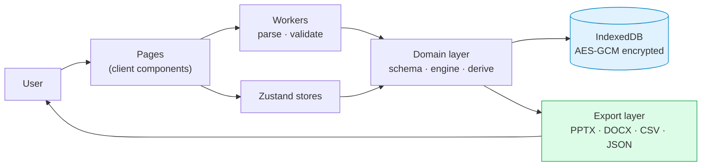

# VHSND & PMSMA Supervision Data Pipeline

**An offline browser application that takes a district VHSND supervision survey export (Excel/CSV), finds the contradictions inside it, lets a health officer adjudicate every one of them with a written reason, turns the cleaned data into charts, and emits a ready-to-send PowerPoint deck, Word letter, cleaned CSV and audit file — without a server, an account, or an internet connection.**

[](https://nextjs.org)
[](https://react.dev)
[](https://www.typescriptlang.org)
[](https://vitest.dev)
[](https://nextjs.org/docs/app/building-your-application/deploying/static-exports)


Everything runs inside your own browser. **Nothing is uploaded.**

**Project status:** active development · 19 test files / 212 tests passing · 5 quality gates green · deployment host **not yet specified**.

---

## Table of contents

1. [Overview](#1-overview) · 2. [Screenshots and demo](#2-screenshots-and-demo) ·
3. [Features](#3-features) · 4. [Technology stack](#4-technology-stack) ·
5. [Architecture overview](#5-architecture-overview) · 6. [Project structure](#6-project-structure) ·
7. [Prerequisites](#7-prerequisites) · 8. [Installation and setup](#8-installation-and-setup) ·
9. [Environment variables](#9-environment-variables) · 10. [Running the application](#10-running-the-application) ·
11. [API documentation](#11-api-documentation) · 12. [Database](#12-database) ·
13. [Testing](#13-testing) · 14. [Deployment](#14-deployment) · 15. [Documentation](#15-documentation) ·
16. [Contributing](#16-contributing) · 17. [License](#17-license) ·
18. [Acknowledgements](#18-acknowledgements) · 19. [Contact and support](#19-contact-and-support) ·
20. [Known limitations](#20-known-limitations)

---

## 1. Overview

### What problem does this solve?

Every month, frontline health workers fill in a supervision form for the **VHSND** (Village Health, Sanitation and Nutrition Day) camps and **PMSMA** (Pradhan Mantri Surakshit Matritva Abhiyan) visits. The form is collected with an ODK-style app and exported as a spreadsheet.

Two things then go wrong:

1. **The spreadsheet is messy.** Exports come with two or three header rows, Hindi or translated column titles, sideways (transposed) layouts, and columns that don't line up with the official 253-column VHSND form. Analysts end up renaming columns by hand in Excel.
2. **The numbers contradict each other.** A row can say "session not held" *and* "38 mothers attended". A supervisor can record fewer women sampled than women diagnosed, or a visit date after the submission date. In a spreadsheet nobody notices; in a report those numbers get published.

This tool fixes both, on your own laptop, with a written record of every decision.

### Who it is for

| Audience | Need |
|---|---|
| District / block health officials | Clean an ODK export and produce a defensible report without uploading health data |
| Programme reviewers and auditors | Reconstruct *why* each row was kept, dropped or overridden, from the audit log and the SHA-256 manifest |
| Data engineers | Extend the schema, rules, indicators and comparisons through a typed DSL rather than ad-hoc code |

### Main value proposition

**A reported number can be traced back to the row it came from.** Every keep / drop / override carries a written justification, every export carries a SHA-256 manifest over the report context and the cleaned rows, and the whole thing runs with no server so district machines never have to be trusted with a network.

### The five screens

| Step | Screen | What you do | What the tool does |
|---|---|---|---|
| 0 | **Home** `/` | Pick a previously imported dataset, or start fresh | Lists the four stages and datasets already stored on this machine |
| 1 | **Ingest** `/ingest` | Drag and drop an `.xlsx`, `.xls`, `.ods` or `.csv` export | Reads the file, works out where the header is, matches your column titles to the official codes, types every cell, and reports what it could and could not understand |
| 2 | **Review** `/review` | Filter contradictions by severity, click a row, decide **keep**, **drop** or **override**, and type a reason | Runs 37 cross-field rules plus per-cell type checks; blocks you from continuing while any *error*-severity finding is unresolved; writes every decision to an audit log |
| 3 | **Visualise** `/viz` | Choose one of **21 indicators** or **21 comparison charts**, accept a recommended chart type, optionally set a palette, then **Add to report** | Computes the numbers, renders the chart, and captures a high-resolution PNG for the deck |
| 4 | **Report** `/report` | Download the deck, the letter, the cleaned data, and the audit trail | Builds all four files locally, seals them with a SHA-256 manifest, and offers **Erase all local data** |

You can stop at any point: your work is saved in the browser, so closing the tab and coming back lands you where you left off.

### What you get out

| File | What it is |
|---|---|
| `vhsnd-report-YYYY-MM-DD.pptx` | A slide deck: title + manifest, cleaning summary, key indicators, one slide per chart you added, and the audit log as an appendix |
| `vhsnd-report-YYYY-MM-DD.docx` | A Word letter built from the embedded `templates/default/vhsnd-letter.docx`, with `{{…}}` placeholders and the same charts embedded |
| `cleaned-<name>.csv` | The adjudicated data — columns labelled `Label (CODE)`, booleans as `1`/`0` |
| `audit-<name>.json` | Machine-readable provenance: every resolution, counts, timings, the schema hash and the SHA-256 manifest |

Every export carries the same **manifest**: a SHA-256 hash of the report context plus a hash of the row values, so two copies of a report can be compared byte-for-byte.

---

## 2. Screenshots and demo

> **⚠️ No screenshots exist in this repository yet.** The sections below are placeholders — no image files, no demo URL, and no live deployment has been published. Do not add broken image links.
>
> **To add screenshots:** drop the PNGs into `docs/screenshots/` and reference them as `docs/screenshots/<name>.png`. Suggested captures, in priority order:
>
> 1. `/ingest` — the unmatched-title mapping card (the most complex UI in the app)
> 2. `/ingest` — the "This export was sideways" orientation notice
> 3. `/review` — a row open in `RowDrawer` with the keep / drop / override controls
> 4. `/viz` — the withheld "Cannot show this in full" card
> 5. `/viz` — a chart with the shared tooltip open, showing the numbers behind the percentage
> 6. `/review` — the unresolved-error blocking banner
> 7. `/report` — the manifest statistics
> 8. `/` — the landing screen
>
> A local demo is available with `npm run dev` — see [§10](#10-running-the-application).

---

## 3. Features

### Core features

- **Offline-first ingestion** — drop `.xlsx` / `.xls` / `.ods` / `.csv`; parsed in a Web Worker, never uploaded.
- **Automatic header resolution** — a five-step ladder (exact code → embedded code token → numbering-stripped label → fuzzy Dice match → near-word match) that rejects ambiguity rather than guessing.
- **Transposition detection** — a sideways export (fields down column A) is detected from two independent signals and can be re-read manually.
- **Multi-row header detection** — a three-row ODK export (Hindi labels / English labels / codes) resolves correctly instead of collapsing the `*_SP` columns.
- **254-column schema with 129 fields and 37 cross-field rules** — 11 error, 23 warning, 3 info.
- **Human adjudication with justification** — keep / drop / override; drop and override require a written reason, and override values are re-validated against the schema.
- **21 indicators and 21 comparisons across 6 categories**, rendering 18 chart kinds.
- **Partial-data honesty** — a comparison whose inputs the file lacks is *withheld* behind an explicit opt-in, so a partial file can never be read as a smaller result.
- **Four export formats** — PPTX, DOCX, cleaned CSV, audit JSON.
- **SHA-256 manifest** binding every export to the exact cleaned rows it was built from.

### User features

- Saved datasets with a picker; work survives a reload.
- Severity filters and an audit log of every decision.
- Dataset / cleaning / viz insight panels (present, present-but-empty, missing, sparse).
- Saved chart gallery with removal.
- **Erase all local data** — deletes both databases, key included.

### Administrative features

- Single operator model with no accounts. *(No multi-user or role model exists — see [§20](#20-known-limitations).)*
- Header remappings saved per file name and replayed on the next import of that file.

### Technical features

- Strict TypeScript, ESLint 9 flat config, Vitest (19 files / 212 tests), React Compiler enabled.
- Static export (`output: "export"`) — no server at runtime.
- Pure worker payload functions, so the parse and validation stages are testable in Node.
- Canonical JSON + SHA-256 for reproducible report provenance.

### Security features

- AES-256-GCM encryption at rest for every persisted value, with a per-origin key in a separate database.
- Content-Security-Policy `<meta>` tag restricting the app to its own origin.
- An offline build gate (`npm run build:check-offline`) that fails the build if any built file references a remote URL.
- No network calls anywhere in the source.

### Incomplete or planned

| Item | Status |
|---|---|
| PMSMA dataset kind | **Type only** — `SUPPORTED_DATASET_KINDS = ["vhsnd"]` (`src/schema/index.ts:5`) |
| `MISSING_REQUIRED` enforcement | **Declared but never emitted** — `required: true` on `B8` has no producer |
| Service worker / installable PWA | **Not implemented** |
| Authentication, multi-user, roles | **Not implemented** |
| CI/CD, coverage reporting | **Not configured** |
| Key export / passphrase / recovery | **Not implemented** |

---

## 4. Technology stack

| Package | Version | Why it is here |
|---|---|---|
| `next` | 16.3.6 (pinned) | App Router + static export (`output: "export"`); all five pages are `"use client"` |
| `react` / `react-dom` | 19.2.8 (pinned) | UI layer |
| `typescript` | 5.9.3 | `strict: true`, `noEmit`, `@/*` → `src/*` alias |
| `zustand` | ^5.0.15 | Four small stores; the workflow store is wrapped in `persist` over an **encrypted** storage adapter |
| `xlsx` | `file:vendor/xlsx-0.20.3.tgz` | Workbook parsing, dynamically imported inside the worker. **Vendored tarball** — SheetJS no longer publishes current versions to public npm |
| `recharts` | ^3.10.1 | Renders 14 of the 18 chart kinds; the other four (box, gauge, waffle, heatmap) are hand-drawn SVG in `ChartCanvas.tsx` |
| `pptxgenjs` | ^4.0.1 | Deck generation |
| `docx-templates` | ^4.15.0 | DOCX rendering with `{{…}}` commands, `FOR` loops and `IMAGE` |
| `html-to-image` | ^1.11.13 | `toPng` capture of the live chart node at pixel ratio 2 |
| `idb-keyval` | ^6.3.0 | Used *only* for the crypto-key store; the main database is hand-rolled so it can be versioned |
| `react-dropzone` | ^20.1.2 | Ingest drag-and-drop |
| `zod` | ^4.6.5 | **Declared but never imported** — no `from "zod"` anywhere in `src/`, `tests/` or `scripts/`. Its only lockfile dependents are dev-side, so removal is safe |

Dev dependencies: `typescript ^5`, `eslint ^9` + `eslint-config-next` (flat config), `vitest ^5.0.1`, `babel-plugin-react-compiler ^1.0.0` (required by `reactCompiler: true`), `@types/*`.

`package.json` also pins `"overrides": { "image-size": "2.0.4" }`, forcing `pptxgenjs`'s transitive `image-size@^1.2.1` down to 2.0.4.

**Platform APIs used:** IndexedDB (persistence), Web Crypto (`crypto.subtle` — AES-GCM and SHA-256), Web Workers (off-thread parsing and validation), `File.arrayBuffer()`, `canvas.toDataURL()`.

Full detail with usage sites and relationships: [`docs/02-technology-stack.md`](docs/02-technology-stack.md).

---

## 5. Architecture overview

A Next.js 16 / React 19 single-page application, statically exported, that runs the entire pipeline on-device:

```
 .xlsx / .xls / .ods / .csv
        │
        ▼
 ┌─ Stage 1  PARSE ──────────────────────────────┐
 │ SheetJS in a Web Worker → array-of-arrays      │
 └────────────────────────────────────────────────┘
        │  ▼
 ┌─ Stage 2  LAYOUT ─────────────────────────────┐
 │ detectHeaderLayout: scan rows 1–3 for codes   │
 │ (headerNormalizer.ts) · optional transposition│
 └────────────────────────────────────────────────┘
        │  ▼
 ┌─ Stage 3  MAP ────────────────────────────────┐
 │ title → code ladder: exact → code token →      │
 │ numbering-stripped → near-word fuzzy → override│
 │ unmapped titles → UI re-match                 │
 └────────────────────────────────────────────────┘
        │  ▼
 ┌─ Stage 4  NORMALISE ──────────────────────────┐
 │ type map per field · cell coercers · sentinels│
 │ group explosion · collapse duplicate titles ·  │
 │ presentColumns                                 │
 └────────────────────────────────────────────────┘
        │  ▼
 ┌─ Stage 5  VALIDATE ───────────────────────────┐
 │ per-cell type/range/value-set checks          │
 │ + 37 cross-field rules → Violation[]          │
 └────────────────────────────────────────────────┘
        │  ▼
 ┌─ Stage 6  ADJUDICATE ─────────────────────────┐
 │ keep / drop / override + mandatory reason     │
 │ → Resolution[] → audit log                    │
 └────────────────────────────────────────────────┘
        │  ▼
 ┌─ Stage 7  DERIVE ─────────────────────────────┐
 │ 21 indicators · 21 comparisons · 18 chart     │
 │ kinds · insight strings                       │
 └────────────────────────────────────────────────┘
        │  ▼
 ┌─ Stage 8  EXPORT ─────────────────────────────┐
 │ PPTX · DOCX · cleaned CSV · audit JSON        │
 │ + SHA-256 manifest over context and rows      │
 └────────────────────────────────────────────────┘
```

There is **no backend and no HTTP API**. The "API" of this application is the TypeScript module boundary between its layers — see [`docs/08-api-documentation.md`](docs/08-api-documentation.md).



Detailed architecture: [`docs/04-system-architecture.md`](docs/04-system-architecture.md) · [`docs/diagrams/system-architecture.md`](docs/diagrams/system-architecture.md) · [`docs/PIPELINE.md`](docs/PIPELINE.md) §3.

---

## 6. Project structure

```
.
├── README.md               ← you are here
├── PROJECT_CONTEXT.md      single-file source of truth, every claim cited
├── AGENTS.md               agent rules block, rewritten by `next dev` / `next build`
├── CLAUDE.md               one line: `@AGENTS.md`
├── next.config.ts          output:"export", trailingSlash, distDir:"out", reactCompiler
├── tsconfig.json           strict, `@/* → ./src/*`
├── vitest.config.ts        node environment, tests/**/*.test.ts
├── eslint.config.mjs       next/core-web-vitals + typescript, *.cjs override
│
├── data/
│   └── vhsnd-columns.csv   source of truth: 253 `label,code` rows
├── docs/                   README, 20 numbered references, AI_AGENT_CONTEXT, diagrams/
├── sample-data/            vhsnd-sample.xlsx, DATASET_1.xlsx, DATA_EX_SHAPE.csv
├── scripts/                9 build/diagnostic/generator scripts
├── src/
│   ├── app/                5 routes: page, ingest, review, viz, report
│   ├── components/         AppShell, ChartCanvas, RowDrawer, SummaryCard, …
│   ├── contracts/          shared types: dataset, violation, indicator, chart, resolution
│   ├── export/             CSV, PPTX, DOCX, report context + manifest, embedded templates
│   ├── lib/                comparisons, insights, crypto, workers, derive, storage/idb
│   ├── schema/             registry, DSL, versions/v2026-1, engine/*, indicators
│   ├── stores/             zustand: workflow, dataset, resolution, chart
│   └── workers/            parseWorker, validateWorker
├── templates/default/      the DOCX letter template
├── tests/                  19 test files, 212 tests
└── vendor/                 xlsx-0.20.3.tgz (SheetJS is not on public npm anymore)
```

`src/` holds **50 files / 10,521 lines**. A full file-by-file inventory is in [`docs/PIPELINE.md` §7](docs/PIPELINE.md) and [`docs/03-project-structure.md`](docs/03-project-structure.md).

---

## 7. Prerequisites

| Requirement | Notes |
|---|---|
| **Node.js** | Modern LTS. `@types/node@^24.13.6` is declared, so Node 24 typings are assumed |
| **npm** | A recent npm; `package-lock.json` is committed and `npm ci` reproduces the tree |
| **A browser** | Chrome, Edge or Firefox. Web Workers, Web Crypto and IndexedDB are required |
| **A secure context** | `crypto.subtle` needs HTTPS or `localhost` — without it, encryption and the SHA-256 manifest fail |
| **A survey export** | `.xlsx`, `.xls`, `.ods` or `.csv` |

**No database, no server, no Docker, no login** is required to run the app.

---

## 8. Installation and setup

```bash
git clone https://github.com/adityapandey2002/PIPELINE-FOR-VHSND-PMSMA.git
cd PIPELINE-FOR-VHSND-PMSMA      # see the warning about "&" below
npm install
npm run dev                       # http://localhost:3000
```

Then: **Ingest** → drop `sample-data/vhsnd-sample.xlsx` (160 rows, nine planted contradictions) → **Review** → **Visualise** → **Report**.

> **Warning — the folder name contains `&`.** If your checkout path includes an ampersand (as this one does), every command that shells out through `node_modules/.bin` breaks, because `cmd` splits the path at `&`. `npx tsc`, `npm run lint` and `npm test` all fail with a *"'…\node_modules\.bin\' is not recognized"* error. Two workarounds:
>
> 1. **Preferred:** clone to a path without `&`.
> 2. Or invoke the binaries directly through `node` — see [§10](#10-running-the-application) and [`docs/DEVELOPMENT.md`](docs/DEVELOPMENT.md).
>
> Scripts that call `node scripts/*.mjs` directly (for example `npm run build:check-offline`) keep working either way.

**Fixtures** for trying the app: `sample-data/vhsnd-sample.xlsx` (160 rows with deliberately broken records), `sample-data/DATASET_1.xlsx` (a real label-headed export), `sample-data/DATA_EX_SHAPE.csv` (a two-row ODK-style CSV twin).

More detail: [`docs/11-installation-and-setup.md`](docs/11-installation-and-setup.md).

---

## 9. Environment variables

**There are none.** `process.env` does not appear anywhere in `src/`. There is no `.env.example`, and `.gitignore` excludes `.env*` as a default rather than because the app needs one.

| Variable | Required | Purpose | Default |
|---|---|---|---|
| *(none)* | — | The application is fully static and needs no server-side configuration | — |

If a future change introduces one, it must be added to [`docs/10-configuration-and-environment.md`](docs/10-configuration-and-environment.md) with the same table shape. Never commit a real secret; `.env*` is already ignored.

---

## 10. Running the application

| Task | Command (npm) | Command (works even with `&` in the path) |
|---|---|---|
| Development server | `npm run dev` | `node .\node_modules\next\dist\bin\next dev --turbo --port 3000 --hostname 127.0.0.1` |
| Production build | `npm run build` | `node .\node_modules\next\dist\bin\next build` |
| Serve the export | *any static file server* | serve `out/` over HTTP(S) — see [§14](#14-deployment) |
| Tests | `npm run test` | `node .\node_modules\vitest\vitest.mjs run` |
| Tests, watch | `npm run test:watch` | `node .\node_modules\vitest\vitest.mjs` |
| Lint | `npm run lint` | `node .\node_modules\eslint\bin\eslint.js .` |
| Type check | `npm run typecheck` | `node .\node_modules\typescript\lib\tsc.js --noEmit` |
| Offline gate | `npm run build:check-offline` | `node .\scripts\check-offline.mjs` |
| Everything | `npm run ci` | typecheck → lint → test → build |

> **`npm start` does not work for this project.** `next start` requires a server build, and `output: "export"` + `distDir: "out"` produces a static export instead. The production path is to serve `out/` with any static file server.

More detail: [`docs/11-installation-and-setup.md`](docs/11-installation-and-setup.md) · [`docs/12-development-guide.md`](docs/12-development-guide.md).

---

## 11. API documentation

**There is no HTTP API.** Verified: no `route.ts` anywhere under `src/`, no server actions, no `middleware.ts`, no `src/app/api/`. `next.config.ts:4` sets `output: "export"`, so no server exists at runtime, and the CSP restricts `connect-src` to `'self' data: blob:`.

The application's public surface is its **TypeScript module boundary**:

| Layer | Module | Exports |
|---|---|---|
| Schema | `src/schema/index.ts` | `SCHEMA_VERSION`, `SUPPORTED_DATASET_KINDS`, `getSchema`, `getDatasetSchema`, `canonicalSchemaJson`, `computeSchemaHash` |
| Engine | `src/schema/engine/normalize.ts` | `detectTransposed`, `transposeAoa`, `detectHeaderLayout`, `applyHeaderOverrides`, `normalizeAoa`, `buildFieldCoercer` |
| Engine | `src/schema/engine/headerNormalizer.ts` | `buildHeaderMap` → `.normalize(text)` |
| Engine | `src/schema/engine/validate.ts` | `validateRows(rows, schema, options)` → `{violations, counts, byRow}` |
| Derivation | `src/lib/derive.ts` | `deriveCleanRows`, `unresolvedErrors` |
| Workers | `src/lib/workers.ts` | `runParse(task, onProgress)`, `runValidate(task, onProgress)` |
| Analysis | `src/schema/indicators.ts` | `VHSND_INDICATORS`, `evaluateIndicator`, `suggestCharts` |
| Analysis | `src/lib/comparisons.ts` | `COMPARISONS`, `COMPARISON_CATEGORIES` |
| Export | `src/export/reportContext.ts` | `buildReportContext`, `sha256Hex` |
| Export | `src/export/pptxReporter.ts` · `docxReporter.ts` · `csv.ts` | `generatePptxReport`, `renderDocxReport`, `cleanRowsToCsv`, `downloadBlob` |
| Storage | `src/lib/storage/idb.ts` | `saveDataset`, `loadDataset`, `listDatasets`, `deleteDataset`, `saveResolutions`, `loadResolutions`, `saveChartMeta`, `loadChartMetas`, `deleteChart`, `saveChartBlob`, `loadChartBlob`, `saveValidation`, `loadValidation`, `saveHeaderOverrides`, `loadHeaderOverrides`, `eraseAllLocalData` |
| Crypto | `src/lib/crypto.ts` | `encryptString`, `decryptString`, `encryptBytes`, `decryptBytes` |

There is no Swagger or OpenAPI document, because there is no HTTP surface to describe.

Full reference: [`docs/08-api-documentation.md`](docs/08-api-documentation.md).

---

## 12. Database

**There is no SQL or server database.** All persistence is browser **IndexedDB**, with every value encrypted before it is written.

| Database | Version | Stores | Purpose |
|---|---|---|---|
| `vhsnd-pipeline` | 2 | `ds`, `res`, `chart`, `blob`, `validation`, `ui` | Datasets, row resolutions, chart metadata, chart PNG blobs, the validation cache, and UI state (including saved header remappings) |
| `pipeline-crypto` | 1 | `keyval` | The AES-256-GCM key, kept in a **separate database** from the ciphertext |

Stores are **out-of-line** (explicit keys, no `keyPath`) and there are **no indexes** — every read is a full scan of the store. Each operation is its own transaction, one store per transaction, so there is **no cross-store atomicity**.

Migrations are a single explicit `DB_VERSION` bump with an `onupgradeneeded` handler that creates missing stores; there is no migration framework and no seeding step (fixtures are test files).

The conceptual ER diagram, encryption scheme and wipe path are documented in [`docs/07-database-documentation.md`](docs/07-database-documentation.md) and [`docs/diagrams/database-er-diagram.md`](docs/diagrams/database-er-diagram.md).

---

## 13. Testing

**19 test files / 212 tests**, all passing, in a **node** environment (`vitest.config.ts:6`). There is **no browser or e2e harness** — no Playwright, no jsdom, no React Testing Library — which is why the worker payload functions are written as pure, directly testable functions.

| Gate | Command | Baseline |
|---|---|---|
| Types | `node .\node_modules\typescript\lib\tsc.js --noEmit` | clean |
| Lint | `node .\node_modules\eslint\bin\eslint.js .` | clean |
| Tests | `node .\node_modules\vitest\vitest.mjs run` | 19 files / 212 tests pass |
| Build | `node .\node_modules\next\dist\bin\next build` | `out/`, 6 routes |
| Offline | `node .\scripts\check-offline.mjs` | OK — no remote references |

`npm run ci` chains the first four; it does **not** include the offline gate.

**Not covered by tests:** UI components, pages/routes, worker wiring, the storage layer, the crypto module, the stores, most export writers, and manifest determinism. There is **no coverage configuration or threshold**, and **no CI**.

More detail: [`docs/13-testing-and-quality.md`](docs/13-testing-and-quality.md).

---

## 14. Deployment

`npm run build` produces a **pure static export** in `out/` — plain HTML, CSS and JS. No Node process, no database, no server-side rendering.

```
out/index.html
out/ingest/index.html
out/review/index.html
out/viz/index.html
out/report/index.html
out/_not-found/index.html
out/_next/**
```

**Serving requirements:** HTTPS (or `localhost`, for `crypto.subtle`), a static file server honouring directory indexes (`trailingSlash: true`), and correct MIME types for module workers.

**`file://` is not supported.** The export emits root-absolute `/_next/...` asset URLs, `crypto.subtle` is unavailable in a `file://` origin, and module workers are restricted there. "Offline" means *served over HTTP from a local file share*, not *opened from a USB stick*.

> **The hosting provider, production URL, operator and rollout procedure are not documented anywhere in this repository.** There is no Dockerfile, no CI configuration, and no hosting config. Treat this as an open decision — see [`docs/14-deployment-and-infrastructure.md`](docs/14-deployment-and-infrastructure.md).

**Build gotcha:** `distDir: "out"` means `next build` **deletes `out/dev/`**, which breaks a running `next dev` until you restart it. `next dev` and `next build` also rewrite the `AGENTS.md` rules block — commit it with your work rather than deleting it, or your diff never goes clean.

More detail: [`docs/14-deployment-and-infrastructure.md`](docs/14-deployment-and-infrastructure.md) · [`docs/diagrams/deployment-architecture.md`](docs/diagrams/deployment-architecture.md).

---

## 15. Documentation

| Document | Audience | Contents |
|---|---|---|
| [`docs/README.md`](docs/README.md) | Everyone | The documentation index and topic map |
| [`docs/01-project-overview.md`](docs/01-project-overview.md) | Everyone | What the app does, the problem, design principles, scope reality |
| [`docs/02-technology-stack.md`](docs/02-technology-stack.md) | Everyone | Every technology, where it is used, why it matters |
| [`docs/03-project-structure.md`](docs/03-project-structure.md) | Contributors | Annotated tree, generated files and how to regenerate them |
| [`docs/04-system-architecture.md`](docs/04-system-architecture.md) | Architects | Layering, dependency direction, cross-cutting concerns |
| [`docs/05-application-workflows.md`](docs/05-application-workflows.md) | Everyone | Sequence diagrams for the four user journeys |
| [`docs/06-modules-and-features.md`](docs/06-modules-and-features.md) | Developers | Catalogue of all 50 `src/` modules + feature inventory |
| [`docs/07-database-documentation.md`](docs/07-database-documentation.md) | Developers | Both IndexedDB databases, encryption, ER diagram |
| [`docs/08-api-documentation.md`](docs/08-api-documentation.md) | Developers | The TypeScript module-boundary API |
| [`docs/09-authentication-and-authorization.md`](docs/09-authentication-and-authorization.md) | Security | Proof that auth is absent, the real trust model |
| [`docs/10-configuration-and-environment.md`](docs/10-configuration-and-environment.md) | Everyone | No env vars, every config file, all npm scripts |
| [`docs/11-installation-and-setup.md`](docs/11-installation-and-setup.md) | Contributors | Setup, run, the Windows `&` workaround |
| [`docs/12-development-guide.md`](docs/12-development-guide.md) | Contributors | Conventions, coding standards, extension recipes, pitfalls |
| [`docs/13-testing-and-quality.md`](docs/13-testing-and-quality.md) | Contributors | Test inventory, gates, what is untested |
| [`docs/14-deployment-and-infrastructure.md`](docs/14-deployment-and-infrastructure.md) | Operators | Build artefact, serving, `file://` prohibition |
| [`docs/15-security-documentation.md`](docs/15-security-documentation.md) | Security | Threat model, CSP, encryption at rest, gaps |
| [`docs/16-error-handling-and-logging.md`](docs/16-error-handling-and-logging.md) | Developers | Actual error patterns; the logging reality |
| [`docs/17-integrations-and-third-party-services.md`](docs/17-integrations-and-third-party-services.md) | Architects | The bundled libraries; proof nothing integrates over the network |
| [`docs/18-maintenance-and-troubleshooting.md`](docs/18-maintenance-and-troubleshooting.md) | Maintainers | Scripts, recurring tasks, symptom → cause → fix |
| [`docs/19-performance-and-scalability.md`](docs/19-performance-and-scalability.md) | Architects | Scaling risks, measured fixture sizes, mitigations |
| [`docs/20-future-improvements.md`](docs/20-future-improvements.md) | Everyone | Prioritised proposals — explicitly **not** commitments |
| [`docs/PIPELINE.md`](docs/PIPELINE.md) | Developers, auditors | The authoritative line-cited codemap: all 8 pipeline stages, UI map, measured fixture results, file inventory |
| [`docs/DATA-MODEL.md`](docs/DATA-MODEL.md) | Analysts, developers | The 253-column registry, the DSL, all 37 rules, the 21 indicators, the 21 comparisons, extension recipes |
| [`docs/DEVELOPMENT.md`](docs/DEVELOPMENT.md) | Contributors | Setup, gates, scripts, generated-file rules, traps |
| [`docs/AI_AGENT_CONTEXT.md`](docs/AI_AGENT_CONTEXT.md) | AI agents | Practical context for working safely in this repo |
| [`docs/diagrams/`](docs/diagrams/) | Everyone | System architecture, application flow, ER diagram, deployment |
| [`PROJECT_CONTEXT.md`](PROJECT_CONTEXT.md) | Auditors | Single-file source of truth: 20 sections, every claim cited to `file:line` |

---

## 16. Contributing

> **There is no `CONTRIBUTING.md` in this repository.** The conventions below are **proposed**, reconstructed from the existing code and commit history — please confirm or amend them.

1. **Verify all five gates before committing**, in order: typecheck → lint → test → build → offline check.
2. **Cite source in documentation** as `path/to/file.ts:NN`. The existing docs use this convention throughout.
3. **Never hand-edit generated files**: `src/schema/columns-vhsnd.ts`, `src/export/templates.generated.ts`, `AGENTS.md`, `next-env.d.ts`. Edit the source (the CSV, the template) and re-run the generator.
4. **Comments only where the code cannot explain itself.** JSDoc on exported APIs is welcome.
5. **Strict TypeScript, no `: any`.** `as unknown as` is acceptable only at Web API and untyped-library boundaries — there are currently nine such casts, all enumerated in [`docs/12-development-guide.md`](docs/12-development-guide.md).
6. **Use the `@/*` path alias** rather than relative traversals.
7. **Commit messages**: lowercase imperative subjects, no trailing period (`28/28` commits follow this). Reference the issue or the behaviour change in the body.
8. **Update the docs in the same commit as the code they describe.**
9. **Do not add dependencies** without a stated need — the app deliberately has no server-side dependencies.

---

## 17. License

**No license has been specified.** There is no `LICENSE` file in this repository and `package.json` has no `license` field. The repository is marked `"private": true`.

Until a license is chosen, treat the code as **all rights reserved**. If this is intended to be open source, adding a license is an outstanding decision — see [`docs/20-future-improvements.md`](docs/20-future-improvements.md).

---

## 18. Acknowledgements

- **Next.js**, **React**, **TypeScript**, **Zustand**, **Vitest**, **ESLint** — the application framework.
- **SheetJS (`xlsx`)** — spreadsheet parsing, vendored as `vendor/xlsx-0.20.3.tgz` because current versions are not published to public npm.
- **recharts** — chart rendering, supplemented by four hand-built SVG renderers.
- **pptxgenjs** and **docx-templates** — PowerPoint and Word generation.
- **html-to-image** — chart rasterisation.
- **react-dropzone** — file input.
- **idb-keyval** — the crypto-key store.
- The **VHSND supervision form** and its 253-column registry, derived from the specification text in `pdf-extracted.txt` at the repository root.

---

## 19. Contact and support

- **Repository:** https://github.com/adityapandey2002/PIPELINE-FOR-VHSND-PMSMA
- **Issues:** https://github.com/adityapandey2002/PIPELINE-FOR-VHSND-PMSMA/issues

No public contact address, website or chat channel is published for this project.

---

## 20. Known limitations

Short version — the full list with citations is in [`PROJECT_CONTEXT.md` §16](PROJECT_CONTEXT.md) and [`docs/PIPELINE.md` §6](docs/PIPELINE.md):

- **PMSMA is not implemented.** The schema registry only contains `vhsnd` (`src/schema/index.ts:5`); `pmsma` exists as a type but no dataset.
- **`MISSING_REQUIRED` never fires.** A field marked `required: true` produces no finding; missing critical columns are surfaced as copy on the Ingest screen instead.
- **Partial exports are silent about what they left out.** If `SubmissionDate` is absent the reference date is `null`, so every date-dependent rule becomes inapplicable and the review screen can report "0 errors" on a file the parser barely understood.
- **Chart PNGs are frozen at "Add to report" time.** Re-editing a chart later does not update images already captured.
- **No passphrase.** The encryption key lives in IndexedDB; clearing site data makes existing data unreadable, permanently.
- **No error boundary.** An unhandled schema-resolution failure in the row drawer renders a blank page rather than a message.
- **Two scripts are broken** — `npm run make:sample` (ESM syntax in a `.cjs` file) and `scripts/make-shape-sample.mjs` (hard-coded absolute path).

---

<div align="center">

**Your data never leaves this machine.** No server, no account, no network call, AES-GCM encryption at rest, and a one-click erase.

</div>
