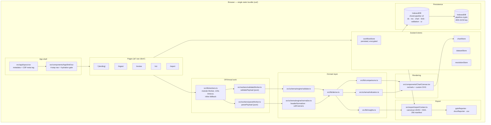

# 04 — System Architecture

> **Scope.** The architectural style, the layer map and import direction, why `src/contracts/` is the
> shared vocabulary, the container and component views, the worker strategy and its fallback, and
> the cross-cutting concerns (errors, caching, logging, background jobs, real-time, third parties,
> authentication, authorisation), plus an end-to-end walkthrough.
>
> **Evidence rule.** Every non-trivial claim is cited as `file:line` and was read from the working
> tree. Anything that could not be established from the repository is written as
> **"Not verified from the current repository."**
>
> **Companions** — [`PROJECT_CONTEXT.md`](../PROJECT_CONTEXT.md) §4 · [`PIPELINE.md`](PIPELINE.md) §2–3 ·
> [`03-project-structure.md`](03-project-structure.md) · [`05-application-workflows.md`](05-application-workflows.md) ·
> [`07-database-documentation.md`](07-database-documentation.md) ·
> [`diagrams/system-architecture.md`](diagrams/system-architecture.md).

---

## 1. Architectural style

A **layered, client-only static web application**. There is no server tier, no API tier, and no
shared runtime between a "frontend" and a "backend" — every stage from reading a file to writing a
download runs inside the browser.

| Fact | Evidence |
|---|---|
| The build is a pure static export; no Next.js server exists at runtime | `next.config.ts:4` (`output: "export"`) |
| Output directory `out/`, directory-style URLs | `next.config.ts:5-6` |
| Every page is a client component | `src/app/page.tsx:1`, `src/app/ingest/page.tsx:1`, `src/app/review/page.tsx:1`, `src/app/viz/page.tsx:1`, `src/app/report/page.tsx:1` |
| The root layout is a thin server shell: metadata + CSP | `src/app/layout.tsx:4-8,27-35` |
| No network call to any host exists in `src/` | `src/app/layout.tsx:19` (`connect-src 'self' data: blob:`); the only `fetch` reads a `data:` URL (`src/app/viz/page.tsx:135`) |
| The build fails if the bundle references a remote URL | `scripts/check-offline.mjs:18-34` |

"Client-only" is a claim about **where the data lives**: the dataset, the decisions, the chart
images and the AES key are all in the user's own browser profile
(see [`07-database-documentation.md`](07-database-documentation.md)).

**Why this shape.** The threat model is in the code itself: health data on shared district machines
must be protected at rest "without the user-friction of passphrases" (`src/lib/crypto.ts:9-17`). A
server would have to hold the key, and a server is somewhere data can be subpoenaed, misconfigured
or intercepted. Removing the server removes that whole class of problem; the cost — no shared
multi-user state, no server-side validation, no background processing — is one this product accepts.

---

## 2. Layer map and import direction

```
routes (src/app)   →  state (src/stores)  →  domain (src/schema, src/lib)  →  contracts (src/contracts)
                                                        ↓                    ↑
                                          persistence (src/lib/storage, src/lib/crypto)
```

The eight layers are: **Routes** (`src/app/**`) · **Components** (`src/components/**`) · **State**
(`src/stores/**`) · **Workers** (`src/workers/**`, `src/lib/workers.ts`) · **Domain**
(`src/schema/**`, `src/lib/{derive,insights,comparisons,ingestCopy}.ts`) · **Persistence**
(`src/lib/storage/idb.ts`, `src/lib/crypto.ts`) · **Export** (`src/export/**`) · **Contracts**
(`src/contracts/**`). The per-file map of each layer is in
[`03-project-structure.md`](03-project-structure.md) and [`PIPELINE.md`](PIPELINE.md) §7; this
document covers only how the layers relate.

### 2.1 Import direction (verified)

`src/contracts/` is a **leaf layer**: no file in it imports anything from `@/` at all. The only
cross-file import inside the directory is relative — `src/contracts/resolution.ts:16` imports
`./dataset`.

| From | May import | Evidence |
|---|---|---|
| `src/contracts/*` | nothing outside `src/contracts` | grep for `import … from "@/"` in `src/contracts` → no matches |
| `src/schema/**` | `src/contracts/*`, `src/schema/**` | `src/schema/dsl.ts:1-2`, `src/schema/engine/validate.ts:1-3`, `src/schema/indicators.ts:1-8` |
| `src/lib/**` | `src/contracts/*`, `src/schema/**`, `src/lib/**`, `src/workers/*` (types only) | `src/lib/derive.ts:1-8`, `src/lib/comparisons.ts:1-4`, `src/lib/workers.ts:1-5` |
| `src/workers/**` | `src/contracts/*`, `src/schema/**`, `src/lib/workerScope.ts` | `src/workers/parseWorker.ts:1-2`, `src/workers/validateWorker.ts:1-4` |
| `src/stores/**` | `src/contracts/*`, `src/schema/**`, `src/lib/storage/idb.ts` | `src/stores/datasetStore.ts:1-13`, `src/stores/chartStore.ts:1-3` |
| `src/export/**` | `src/contracts/*`, `src/schema/**`, `src/lib/derive.ts`, `src/export/*` | `src/export/reportContext.ts:1-6`, `src/export/csv.ts:1-3` |
| `src/app/**`, `src/components/**` | everything above | `src/app/viz/page.tsx:3-20` |

**One documented wrinkle.** `src/lib/workers.ts:4-5` imports *types* from `@/workers/parseWorker` and
`@/workers/validateWorker`, while `src/workers/parseWorker.ts:2` imports `@/lib/workerScope`. The
cycle exists only at the type level (`import type`), so it erases at compile time. The reason it
exists: `runParse`/`runValidate` need the request/response shapes to stay in step with the workers
that implement them.

---

## 3. Why `src/contracts/` is the shared vocabulary

There is no network API, so the only real public surface of this application is **TypeScript module
boundaries**. `src/contracts/` is where those boundaries are drawn, and it is the one layer every
other layer may depend on.

| File | What it pins down |
|---|---|
| `src/contracts/dataset.ts` | `CellValue` (`string \| number \| boolean \| null`), `NormalizedRow`, `DatasetSnapshot`, `DatasetSummary`, `SourceMeta`, `DatasetKind` |
| `src/contracts/violation.ts` | `Violation`, `Severity`, `ViolationCategory`, `violationKey`, `keyedViolations` |
| `src/contracts/resolution.ts` | `RowResolution`, `ResolutionStatus`, `CleanRow`, `applyResolution` |
| `src/contracts/chart.ts` | `ChartKind` (18 members), `ChartConfig`, `SavedChart`, `ChartSuggestion` |
| `src/contracts/indicator.ts` | `IndicatorDef`, `Aggregation`, `DataType`, `ComputedStats` |

Three properties make this work as a shared vocabulary:

1. **Types plus a handful of pure functions.** `applyResolution` (`src/contracts/resolution.ts:30-55`)
   and `violationKey`/`keyedViolations` (`src/contracts/violation.ts:42-73`) are pure and total —
   no I/O, no React, no storage — so they are usable from a worker, a page, a test or an exporter
   without adaptation.
2. **The join key is a *code*, not a label.** `NormalizedRow.values` is keyed by the physical column
   code (`src/contracts/dataset.ts:10`), so the same vocabulary works for Hindi labels, English
   labels and codes.
3. **It is the leaf**, so it can be imported by anything without dragging in dependencies.

The practical effect: a client-only app does not collapse into tangled components, because the
"API" between layers is a set of small, stable, well-named records rather than ad-hoc object shapes
passed between files.

---

## 4. Container diagram



The standalone version, with a per-layer key-files table, is in
[`diagrams/system-architecture.md`](diagrams/system-architecture.md).

**Container facts.** There is exactly one container: the browser. No server, no worker process, no
container image, no cloud service. Inside it there are two **stores** (the two IndexedDB databases)
and one **off-thread** environment (the Web Workers). A worker is not a separate container in the
deployment sense — it is a thread inside the same browser process, sharing the same origin, the same
IndexedDB and the same CSP.

---

## 5. Component and dependency analysis

### 5.1 Components

| Component | Entry point | Exposes | Depends on |
|---|---|---|---|
| App shell | `src/components/AppShell.tsx:15` | Nav + hydration gate | `src/stores/workflowStore.ts` |
| Landing | `src/app/page.tsx:42` | Stage cards, dataset table, privacy note | `src/lib/storage/idb.ts`, `src/stores/workflowStore.ts` |
| Ingest | `src/app/ingest/page.tsx:20` | Drop zone, progress, orientation/collapse/unmatched notices, insights | `src/lib/workers.ts`, `src/stores/*`, `src/lib/insights.ts`, `src/lib/storage/idb.ts` |
| Review | `src/app/review/page.tsx:26` | Violation table, filters, drawer, audit log | `src/lib/derive.ts`, `src/lib/insights.ts`, `src/components/RowDrawer.tsx` |
| Visualise | `src/app/viz/page.tsx:22` | Indicator/comparison charts, partial gate, PNG capture | `src/schema/indicators.ts`, `src/lib/comparisons.ts`, `src/components/ChartCanvas.tsx` |
| Report | `src/app/report/page.tsx:22` | PPTX/DOCX/CSV/JSON downloads, manifest stats, wipe | `src/export/*`, `src/lib/storage/idb.ts` |
| Worker runner | `src/lib/workers.ts:47,121` | `runParse`, `runValidate` | `src/workers/*` (dynamic import) |
| Persistence | `src/lib/storage/idb.ts` | 16 read/write helpers + wipe | `src/lib/crypto.ts` |
| Crypto | `src/lib/crypto.ts` | `encryptString`, `decryptString`, `encryptBytes`, `decryptBytes` | `idb-keyval` |

### 5.2 The heaviest dependencies, and why

- **`xlsx`** (SheetJS 0.20.3, vendored tarball `vendor/xlsx-0.20.3.tgz`, `package.json:30`) — the
  only way to read `.xlsx/.xls/.ods`. Loaded *inside the worker* by dynamic `import()`
  (`src/workers/parseWorker.ts:31`), so it never lands in the main bundle's critical path.
- **`recharts`** (`package.json:29`) — 14 of the 18 chart kinds are recharts families; the other 4
  (`box`, `gauge`, `waffle`, `heatmap`) are hand-built SVG/DOM renderers dispatched from
  `src/components/ChartCanvas.tsx:42,208-213`.
- **`pptxgenjs` / `docx-templates`** (`package.json:21,25`) — the only two formats needing a real
  document model; both run only when the user clicks an export button
  (`src/app/report/page.tsx:91,99`).

### 5.3 High fan-in / fan-out

`src/lib/derive.ts` is the pivot of the domain layer: imported by the review page
(`src/app/review/page.tsx:13`), the viz page (`:13`), the report page (`:12`), the insights module
(`src/lib/insights.ts:6`) and the report-context builder (`src/export/reportContext.ts:3`).
Everything that wants "the cleaned rows" asks this one module.

`src/lib/comparisons.ts` is the largest file (1103 lines) and owns 21 comparisons across 6
categories (`src/lib/comparisons.ts:303-310,320-1090`). It is imported only by the viz page
(`src/app/viz/page.tsx:15`) and by the tests, which is why it could be split by category without
touching anything else.

`src/schema/columns-vhsnd.ts` is generated and must not be hand-edited; it is the registry every
other module reads labels from (`src/schema/engine/normalize.ts:4`, `src/schema/indicators.ts:7`,
`src/lib/insights.ts:5`, `src/export/csv.ts:3`).

---

## 6. Worker strategy and fallback

`src/lib/workers.ts` is the single entry point for the two expensive stages, so there is exactly
one place where the thread decision is made.

| Concern | Behaviour | Evidence |
|---|---|---|
| Worker construction | `new Worker(url, { type: "module" })`, `url = new URL("../workers/parseWorker.ts", import.meta.url)` | `src/lib/workers.ts:52-55`, `:130-131` |
| Capability probe | `canUseWorker` builds a worker and immediately terminates it | `src/lib/workers.ts:36-44` |
| Parse timeout | 120 000 ms → `reject(new Error("Parse timed out."))` | `src/lib/workers.ts:62` |
| Validate timeout | 120 000 ms → `reject(new Error("Validation timed out."))` | `src/lib/workers.ts:138` |
| Main-thread fallback | dynamic `import()` of the *same* module, then the same pure payload function | `src/lib/workers.ts:98-115`, `:168-183` |
| Non-browser environment | rejects with `WorkerUnavailableError` | `src/lib/workers.ts:26-33,92-97,164-167` |
| Buffer transfer | the `ArrayBuffer` is transferred, not copied (`postMessage(…, [task.buffer])`) | `src/lib/workers.ts:89` |

**Why the fallback cannot drift.** The worker modules export a **pure payload function** —
`parsePayload` (`src/workers/parseWorker.ts:30-79`) and `validatePayload`
(`src/workers/validateWorker.ts:20-28`) — and wire themselves to `globalThis` separately
(`src/workers/parseWorker.ts:81-96`, `src/workers/validateWorker.ts:30-44`). Both paths call the
same function with the same payload: exactly one implementation of the parse, one of the validation.

**Consequence for testing.** The suite runs in Node (`vitest.config.ts:6`), where `Worker` does not
exist, so `runParse`/`runValidate` would reject. That is precisely why the payload functions are
written as directly testable pure functions. The cost is recorded in
[`PROJECT_CONTEXT.md`](../PROJECT_CONTEXT.md) §15.3: the worker *wiring* is untested.

**Cost of the fallback.** It is not free: on the main thread a large workbook blocks the UI.
`WorkerUnavailableError`'s message says so explicitly (`src/lib/workers.ts:29`).

---

## 7. Error-handling strategy

No error-handling framework, no error boundary, no error-reporting service. The strategy is
**local, typed and user-visible**, in three patterns.

**7.1 Domain errors degrade, they do not crash.** Every cross-field rule is wrapped in `try/catch`
(`src/schema/engine/validate.ts:60-83`); a predicate that throws becomes a `RULE_EVALUATION_ERROR`
violation of severity `warning` (`:72-82`), so one bad predicate can never abort an import.
Similarly `src/lib/derive.ts:30-35` catches a schema-resolution failure and falls back to a `null`
coercer, so an old dataset still opens — the trade-off is that the error is discarded (recorded as
a risk in [`PROJECT_CONTEXT.md`](../PROJECT_CONTEXT.md) §16.3).

**7.2 UI errors are rendered, not thrown.** Every page keeps an error string in state and renders it
in a card: `src/app/ingest/page.tsx:134-137,228-233`, `src/app/report/page.tsx:122-126,210-212`.
Thrown values are stringified with `err instanceof Error ? err.message : String(err)` — the same
idiom at `src/stores/datasetStore.ts:72` and `src/app/report/page.tsx:123`.

**7.3 Form validation happens before persistence.** `src/components/RowDrawer.tsx` refuses to save
an invalid decision: drop/override without a written reason → "A written reason is required for the
audit trail." (`:62,94-97`); override with an empty value → "Enter a replacement value." (`:63-68`);
override with a value the field cannot hold → `coercer.reject(...)` returns "… is not a valid value
for <label>." (`src/schema/engine/normalize.ts:188-196`); keep with errors present and nothing
acknowledged → "Acknowledge at least one error, or choose to keep without acknowledging (stays
unresolved)." (`:79-82`).

| Layer | Mechanism | Example |
|---|---|---|
| Rule evaluation | try/catch → synthetic violation | `src/schema/engine/validate.ts:72-82` |
| Schema resolution | try/catch → null coercer | `src/lib/derive.ts:30-35` |
| Worker | try/catch → `WorkerUnavailableError` | `src/lib/workers.ts:26-33` |
| Decryption | throw on an unknown payload format | `src/lib/crypto.ts:30-33` |
| IndexedDB | promise rejection from `req.onerror` | `src/lib/storage/idb.ts:41,54,64` |
| Pages | error string in state, rendered in a card | `src/app/ingest/page.tsx:134-137` |

**Not verified from the current repository.** There is no React error boundary in `src/app/`
(verified by inspection of `layout.tsx` and the five page files), so a render-time exception would
surface as an unmounted tree rather than a styled error card.

---

## 8. Caching strategy

No HTTP cache, no service worker, no CDN. "Caching" here means **memoising expensive pure
computations in module scope**, plus **reusing persisted artefacts**.

### 8.1 The schema-version-keyed coercer cache

The one cache the architecture depends on is in `src/lib/derive.ts`:

```ts
const coercerCache = new Map<string, FieldCoercer | null>();   // :24

function coercerFor(dataset: DatasetSnapshot): FieldCoercer | null {
  const cacheKey = `${dataset.schemaVersion}:${dataset.kind}`;  // :27
  const cached = coercerCache.get(cacheKey);
  if (cached !== undefined) return cached;                      // :29
  let built: FieldCoercer | null = null;
  try {
    built = buildFieldCoercer(getDatasetSchema(dataset.schemaVersion, dataset.kind).fields);
  } catch { built = null; }                                     // :31-35
  coercerCache.set(cacheKey, built);
  return built;
}
```

Three properties matter: the **key includes the schema version and dataset kind**, so a dataset
saved under an older schema is never coerced with the current schema's rules (`:27`); **`null` is
a cacheable value** — `cached !== undefined` distinguishes "not built yet" from "built and failed",
so a failed resolution is remembered (`:29`); and **`undefined` is deliberately not cached**, so a
dataset whose schema cannot be resolved still yields a working, if uncoerced, clean set.
`buildFieldCoercer` itself compiles a type map and a definition map once per schema
(`src/schema/engine/normalize.ts:175-198`), so the cache turns an O(fields) compilation into a
one-time cost per schema version.

### 8.2 The other caches

| Cache | Key | Where | Why |
|---|---|---|---|
| Header-normaliser memo | the header string | `src/schema/engine/headerNormalizer.ts:417,439-445` | One header runs a five-step ladder; the same label repeats across a sheet |
| Field-type map | module-level singleton | `src/schema/indicators.ts:108-114` | Built once per session |
| IDB connection | a single `dbPromise` | `src/lib/storage/idb.ts:28-45` | Opening IndexedDB is expensive |
| AES key | `cachedKey` | `src/lib/crypto.ts:59-62,80` | Re-importing the key per operation would cost a round trip per record |
| Validation result | `datasetId` in the `validation` store | `src/lib/storage/idb.ts:196-204` | Re-run only on demand (`src/app/review/page.tsx:77-96`) |
| Chart images | PNG blob in the `blob` store | `src/lib/storage/idb.ts:175-185` | A chart is rasterised **once**, at add-time (`src/app/viz/page.tsx:130-134`) |
| Store hydration | `hydratedFor` / `loadedFor` | `src/stores/resolutionStore.ts:7,18`, `src/stores/chartStore.ts:7,23` | Prevents re-reading a store already loaded |
| React memoisation | `useMemo` over derived arrays | `src/app/review/page.tsx:46-75`, `src/app/viz/page.tsx:55-95` | Keeps derivation off the render path |

### 8.3 What is *not* cached

- **Indicators and comparisons are recomputed** on every render whose inputs change
  (`src/app/viz/page.tsx:64-72,78-81`); there is no memoisation inside
  `src/schema/indicators.ts:123-276` or `src/lib/comparisons.ts`.
- **`listDatasets()` decrypts every stored snapshot** to build the landing-page list
  (`src/lib/storage/idb.ts:99-117`) — O(n) decrypts on every landing-page mount
  (`src/app/page.tsx:47-55`).
- There is **no quota management, no TTL and no eviction** of old datasets.

---

## 9. Logging strategy

**There is no logging system.** No logger, no log level, no log sink, no structured logging, no
error-reporting service, no telemetry, no analytics.

Verified by searching `src/` for `console.`, `localStorage`, `sessionStorage`, `setInterval`,
`process.env`, `navigator.`, `serviceWorker`, `fetch(`, `XMLHttpRequest`, `WebSocket` and
`EventSource`. The complete set of hits in the entire application source is:

| Hit | Location | What it is |
|---|---|---|
| `console.error("Chart capture failed:", err)` | `src/app/viz/page.tsx:154` | The **only** `console` call in the codebase — a best-effort report when `html-to-image` fails |
| `fetch(dataUrl)` | `src/app/viz/page.tsx:135` | Reads a `data:` URL into a `Blob`. Not a network request |
| `setTimeout(…, 5000)` | `src/export/csv.ts:40` | Defers `URL.revokeObjectURL` so the download starts |
| `setTimeout(…, 120_000)` | `src/lib/workers.ts:62,138` | The parse/validate timeouts |

Consequences, stated plainly: **nothing is written to a log file**; diagnostics are limited to what
the UI shows at the moment of failure (`src/app/ingest/page.tsx:228-233`,
`src/app/report/page.tsx:210-212`); and **there is no way to collect a support bundle from a field
machine** — a user who hits a bug can only describe it.

The audit trail is **not** a log. `src/export/reportContext.ts:65-74` builds a record of *human
decisions* (what was decided, when, and why) and embeds it in every export — an audit artefact, not
a diagnostic log.

---

## 10. Background jobs

**None.** No scheduler, no queue, no cron, no polling and no service worker. Verified: no
`setInterval` anywhere in `src/`, no `serviceWorker` registration anywhere in `src/`, and no worker
other than the two on-demand parse/validate workers. The only asynchronous work is user-initiated:

| Activity | Trigger | Evidence |
|---|---|---|
| Parse a workbook | the user drops a file | `src/app/ingest/page.tsx:142-169` |
| Validate rows | import completes, or "Re-run validation" | `src/app/ingest/page.tsx:88-99`, `src/app/review/page.tsx:77-96` |
| Rasterise a chart | "Add to report" | `src/app/viz/page.tsx:126-158` |
| Build an export | a download button is clicked | `src/app/report/page.tsx:57-127` |

**No service worker / true offline PWA.** The build is a static export plus a CSP; nothing precaches
the artefact, so "works offline" depends entirely on how `out/` is served. Recorded as **Not found
in codebase** in [`PROJECT_CONTEXT.md`](../PROJECT_CONTEXT.md) §2.2 (F27) and §16.3.

---

## 11. Real-time

**None.** No WebSocket, no Server-Sent Events, no `EventSource`, no long-poll, no BroadcastChannel
and no cross-tab synchronisation.

The only cross-context signal is the **hydration flag** in `workflowStore`: `hydrated` is set by
`onRehydrateStorage` (`src/stores/workflowStore.ts:25-27`) and read by `AppShell`
(`src/components/AppShell.tsx:17,19-32`) to hold back the UI until the encrypted workflow store has
been read. Without it, a reload would flash "no dataset" before the store resolved.

Because every long-running operation returns a promise and updates React state on completion
(`src/app/ingest/page.tsx:81-84`, `src/app/viz/page.tsx:126-158`), the UI is **request/response**,
not streamed.

---

## 12. Third-party integration surface

### 12.1 Runtime libraries (all local, zero network)

| Library | Version | Used at | Network use |
|---|---|---|---|
| `xlsx` (SheetJS) | 0.20.3, **vendored tarball** `vendor/xlsx-0.20.3.tgz` (`package.json:30`) | `src/workers/parseWorker.ts:31-35` | None — reads bytes the user picked |
| `recharts` | ^3.10.1 (`package.json:29`) | `src/components/ChartCanvas.tsx:5-32` | None |
| `pptxgenjs` | ^4.0.1 (`package.json:25`) | `src/export/pptxReporter.ts:1,24` | None |
| `docx-templates` | ^4.15.0 (`package.json:21`) | `src/export/docxReporter.ts:1,25` | None |
| `html-to-image` | ^1.11.13 (`package.json:22`) | `src/app/viz/page.tsx:5,130` | None — rasterises the DOM in-page |
| `react-dropzone` | ^20.1.2 (`package.json:28`) | `src/app/ingest/page.tsx:5,192-200` | None |
| `zustand` | ^5.0.15 (`package.json:32`) | `src/stores/**` | None |
| `idb-keyval` | ^6.3.0 (`package.json:23`) | `src/lib/crypto.ts:1,3,63,79` | None — holds the AES key |

### 12.2 What is **not** integrated

**No external service integration exists — Not found in codebase.** No HTTP client to any
third-party host, no analytics, no telemetry, no error reporting, no auth provider, no payment, no
maps, no messaging, no email, no LLM/AI service.

The DOCX template is the notable case: rather than fetching a template at runtime, the bytes are
**embedded in the bundle** at build time — `src/export/templates.generated.ts`, produced by
`scripts/embed-templates.mjs`, consumed at `src/app/report/page.tsx:11,55`. The generated file's own
header comment states the app "never performs a fetch() for its official templates"
(`src/export/templates.generated.ts:3`).

### 12.3 The egress guarantee

Two mechanisms enforce "nothing is uploaded":

1. **Content-Security-Policy**, injected as a `<meta>` tag in the root layout
   (`src/app/layout.tsx:10-25,31`). `connect-src 'self' data: blob:` (`:19`) means no remote origin
   is connectable; `script-src`/`style-src`/`img-src`/`font-src`/`worker-src` are pinned to the same
   origin (`:15-21`); `object-src 'none'`, `base-uri 'none'`, `form-action 'self'` (`:22-24`) close
   the remaining exfiltration routes.
2. **A build gate**, `scripts/check-offline.mjs`, which scans `out/**/*.{js,html}` for remote URLs
   and exits non-zero if it finds any (`:18-34`). Wired to `npm run build:check-offline`
   (`package.json:16`).

The honest caveat — `script-src` includes `'unsafe-eval'` and `'unsafe-inline'` because a static
export has no server to issue nonces — is discussed in
[`PROJECT_CONTEXT.md`](../PROJECT_CONTEXT.md) §14.2.

### 12.4 Supply-chain note

`xlsx` is installed from a **local vendored tarball** rather than the npm registry
(`"xlsx": "file:vendor/xlsx-0.20.3.tgz"`, `package.json:30`). This is a deliberate
reproducibility/offline-build choice, but it means the tarball is the artefact of record — its
provenance cannot be verified from `package-lock.json` alone.

`zod@^4.6.5` is a declared dependency (`package.json:31`) that is **never imported** anywhere in
`src/`, `tests/` or `scripts/` — the schema system uses its own DSL (`src/schema/dsl.ts`).

---

## 13. Authentication flow

**There is none. The application has no authentication flow of any kind.**

| Mechanism | Status | How verified |
|---|---|---|
| Login screen / sign-in form | **Not found in codebase** | No such component or route; the six routes are `/`, `/ingest/`, `/review/`, `/viz/`, `/report/`, `/_not-found/` |
| Session / token / cookie | **Not found in codebase** | No `localStorage`, `sessionStorage` or cookie usage anywhere in `src/` |
| Identity of the operator | **Not captured** | `RowResolution.decidedBy` is typed as the literal `"user"` (`src/contracts/resolution.ts:13`) and the drawer always writes `"user"` (`src/components/RowDrawer.tsx:89,105,122`). No name, role or machine identity is stored |
| Password / passphrase for the data | **Not found in codebase** | The AES key is generated and stored automatically with no user secret (`src/lib/crypto.ts:74-79`) |
| Identity provider / OAuth / SSO | **Not found in codebase** | No such dependency in `package.json:20-33` |

This is a deliberate single-user design: the app runs in one browser profile on one machine, and the
"workspace" is the local IndexedDB. `src/app/page.tsx:138-145` and `src/app/report/page.tsx:233-236`
state the privacy model to the user directly.

The consequence that matters for a handover: **the audit trail identifies decisions as "user" and
nothing more.** It proves *what* was decided and *when*, but not *who* decided it. See
[`09-authentication-and-authorization.md`](09-authentication-and-authorization.md).

---

## 14. Authorisation flow

**There is none. The application has no authorisation model.**

| Mechanism | Status | How verified |
|---|---|---|
| Roles / permissions / capabilities | **Not found in codebase** | No role, permission or capability type exists in `src/contracts/` |
| Per-route guards | **Not found in codebase** | No middleware (`src/` contains no `middleware.*`), no server action and no route handler — `output: "export"` means no server runtime exists to guard anything |
| Object-level access control | **Not found in codebase** | Every helper in `src/lib/storage/idb.ts` is callable by any code in the bundle; there is no ownership check |
| Row- or dataset-level protection | **Not found in codebase** | `loadDataset(id)` returns whatever snapshot is stored under that id (`src/lib/storage/idb.ts:93-97`) |
| Audit-log write protection | **Not found in codebase** | The audit log is derived from the resolutions map at export time (`src/export/reportContext.ts:65-74`); it is not append-only — a resolution can be reset to `pending` (`src/components/RowDrawer.tsx:256-263`) and re-decided |

What *is* enforced is **data-flow control, not authorisation**: the CSP prevents data leaving the
origin (`src/app/layout.tsx:19`); the build gate fails the ship on a remote URL
(`scripts/check-offline.mjs:18-34`); the report page refuses to export while unresolved errors
remain (`src/app/report/page.tsx:165,180-191`); and the review page refuses to advance to the viz
step (`src/app/review/page.tsx:146-153`). These are **gates on the workflow**, not gates on a
person. Anyone who can open the app can do everything in it.

---

## 15. End-to-end: how it works

The user-facing narrative is in [`05-application-workflows.md`](05-application-workflows.md); the
code map is in [`PIPELINE.md`](PIPELINE.md) §3.

| # | Step | Code |
|---|---|---|
| 1 | The user drops a file; the extension guard accepts `.xlsx/.xls/.ods/.csv`; the raw `ArrayBuffer` is kept in state so the file can be re-read | `src/app/ingest/page.tsx:142-151,159` |
| 2 | Header matches previously saved **for that file name** are loaded | `:160` → `src/lib/storage/idb.ts:224-228` |
| 3 | `runParse` posts the buffer to the worker; the worker reads the workbook with `cellDates: true` and converts it to an **array of arrays**, so repeated "Others (Specify)" labels cannot collapse | `src/lib/workers.ts:80-89`; `src/workers/parseWorker.ts:32-48` |
| 4 | Orientation is resolved: `auto` consults `detectTransposed` (≥30 rows, ≥2:1 ratio, two independent signals) | `src/workers/parseWorker.ts:57-61`; `src/schema/engine/normalize.ts:322-344` |
| 5 | The header block is located — the form's own code row in rows 1–3 (≥90 % known codes), else a repeated-label row, else a single label row | `src/schema/engine/normalize.ts:355-408` |
| 6 | Headers are resolved through the five-step ladder, then the user's saved overrides are applied on top | `src/schema/engine/headerNormalizer.ts:419-437`; `src/schema/engine/normalize.ts:457-471` |
| 7 | `normalizeAoa` keys columns by code, keeps the first occurrence of a repeated code, records the rest as `collapsedColumns` with a `cause`, coerces every cell, skips empty rows and collects `unmappedHeaders` | `src/schema/engine/normalize.ts:480-599` |
| 8 | A dataset is created: a fresh `crypto.randomUUID()`, the current `SCHEMA_VERSION` and the `schemaHash` attached, and the snapshot encrypted into IndexedDB | `src/stores/datasetStore.ts:40-58` → `src/lib/storage/idb.ts:89-91` |
| 9 | `runValidate` runs the three-pass engine and the result is cached in the `validation` store | `src/app/ingest/page.tsx:88-99`; `src/schema/engine/validate.ts:41-95` |
| 10 | The screen reports rows, errors, warnings, recognised columns and missing critical columns, and may raise up to three notices: orientation, collapsed columns, unmatched titles | `src/app/ingest/page.tsx:100-114,234-258,260-276,304-322,324-379` |
| 11 | The review page loads the snapshot, the cached validation and the resolutions; violations are de-duplicated and filtered by severity | `src/app/review/page.tsx:40-51`; `src/contracts/violation.ts:42-73` |
| 12 | "Continue to Visualise" is **disabled** while any unresolved error remains | `src/app/review/page.tsx:146-153`; `src/lib/derive.ts:74-90` |
| 13 | The drawer records the decision: drop and override require a written reason; an override must pass the schema coercer and is re-read through the schema when the clean set is derived | `src/components/RowDrawer.tsx:62-68,113-116`; `src/contracts/resolution.ts:41-52` |
| 14 | Decisions are written to the `res` store as one encrypted blob per dataset | `src/stores/resolutionStore.ts:23-27` → `src/lib/storage/idb.ts:127-129` |
| 15 | Clean rows are derived: pending/keep → kept, drop → dropped, override → merged and re-coerced; kept rows with unresolved errors are reported as `pending` and still flow | `src/lib/derive.ts:40-66` |
| 16 | An indicator is evaluated or a comparison computed | `src/schema/indicators.ts:123-276`; `src/lib/comparisons.ts:320-1090` |
| 17 | **The partial-comparison gate**: a comparison whose `columnsMissing` is non-empty is not drawn until the user opts in; afterwards the chart carries a "Partial view — not in this file: …" line and "Add to report" unlocks | `src/app/viz/page.tsx:83-85,335-366,369-373,413-421` |
| 18 | "Add to report" rasterises the chart card (`pixelRatio: 2`, white background) and stores the PNG **and** the metadata under `` `${datasetId}/${chartId}.png` `` | `src/app/viz/page.tsx:130-134`; `src/stores/chartStore.ts:38-66`; `src/lib/storage/idb.ts:150-185` |
| 19 | The report page re-derives the clean set; export is blocked if `unresolved > 0` **or** the cleaned set is empty | `src/app/report/page.tsx:45-53,165,180-191` |
| 20 | `buildReportContext` assembles the audit records (sorted by `decidedAt`), the summary counts, the headline indicator values, the chart references, a `rowsHash` and the `manifest` — SHA-256 over canonical JSON of the context plus `rowsHash` | `src/export/reportContext.ts:64-119` |
| 21 | Four artefacts are produced in-browser and downloaded via an object URL: PPTX, DOCX, cleaned CSV and the audit JSON | `src/app/report/page.tsx:81-121`; `src/export/pptxReporter.ts:20-112`; `src/export/docxReporter.ts:13-51`; `src/export/csv.ts:17-30` |
| 22 | "Erase all local data" deletes every database whose name begins with `vhsnd-pipeline` or `pipeline-crypto` | `src/app/report/page.tsx:129-134` → `src/lib/storage/idb.ts:260-273` |

`canonicalString` sorts object keys recursively (`src/export/reportContext.ts:35-42`), which is what
makes the manifest reproducible regardless of property-insertion order.

---

## 16. Architectural summary

| Concern | Answer | § |
|---|---|---|
| Style | Layered, client-only static application | 1 |
| Layers | routes → state → domain → contracts, with persistence beneath | 2 |
| Import direction | `contracts` is a leaf; `schema` → `contracts`; `lib` → `schema`/`contracts` | 2.1 |
| Shared vocabulary | `src/contracts/` — types plus a few pure functions | 3 |
| Container | one browser; two IndexedDB stores; workers are threads, not containers | 4 |
| Off-thread work | module Workers, 120 s timeout, identical inline fallback | 6 |
| Error handling | domain errors degrade to synthetic findings; UI errors are rendered | 7 |
| Caching | schema-version-keyed coercer cache + memoised pure functions + persisted artefacts | 8 |
| Logging | **none** — a single `console.error` in the whole codebase | 9 |
| Background jobs | **none** — no scheduler, no polling, no service worker | 10 |
| Real-time | **none** — no socket, no SSE, no cross-tab sync | 11 |
| Third parties | 8 local libraries; **zero** network integrations | 12 |
| Authentication | **none** | 13 |
| Authorisation | **none** | 14 |

**Not verified from the current repository.** Deployment host, production URL, rollout procedure and
operator are unknown — no Dockerfile, hosting config or CI exists
([`PROJECT_CONTEXT.md`](../PROJECT_CONTEXT.md) §13.2). No performance measurement of any kind
exists; the scaling risks in §8 are static analysis of the code paths, not measurements
([`PROJECT_CONTEXT.md`](../PROJECT_CONTEXT.md) §14.5).
