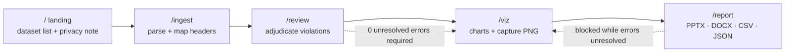
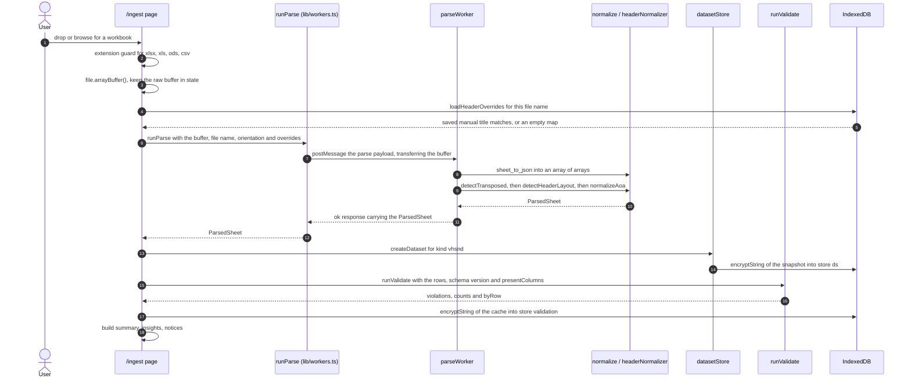
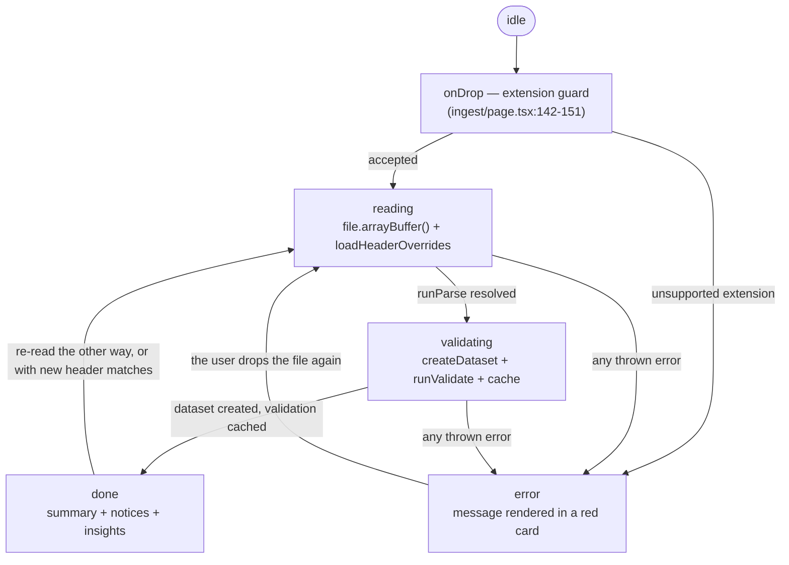
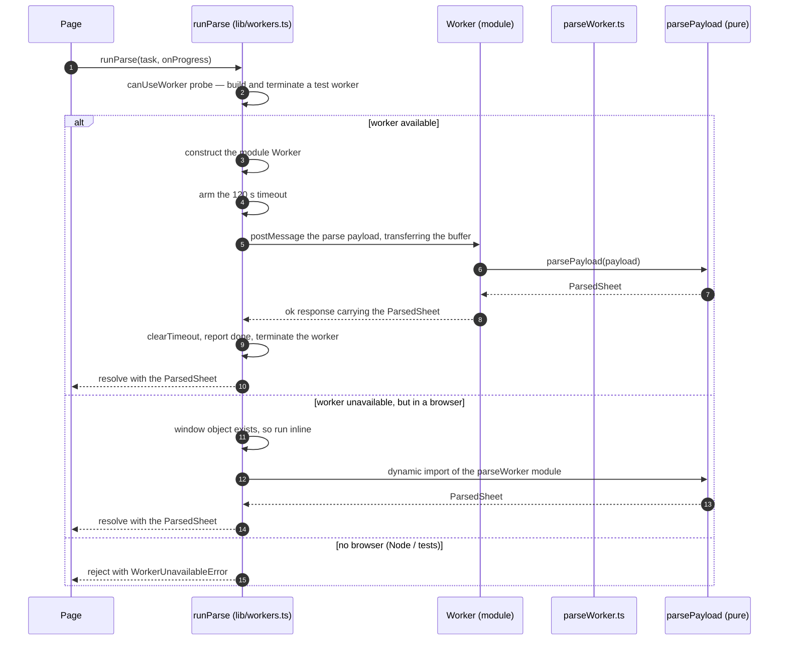
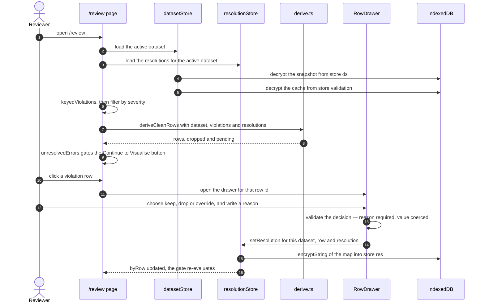
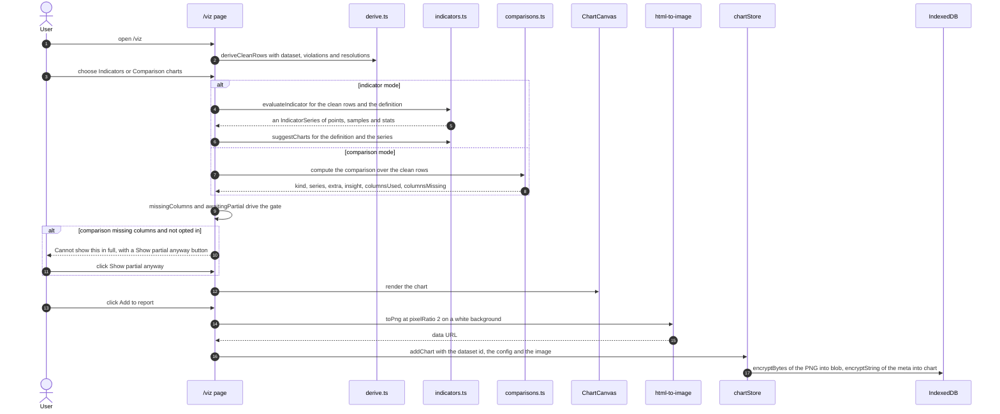
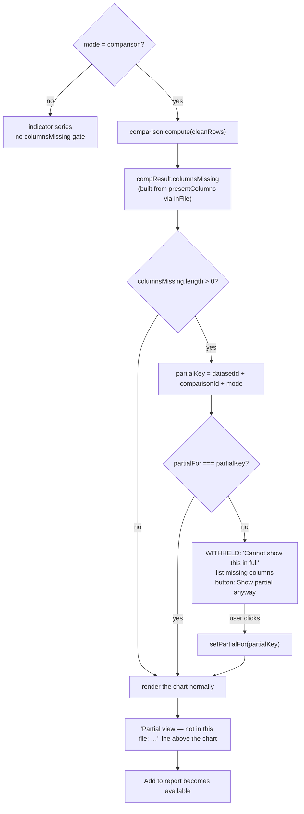
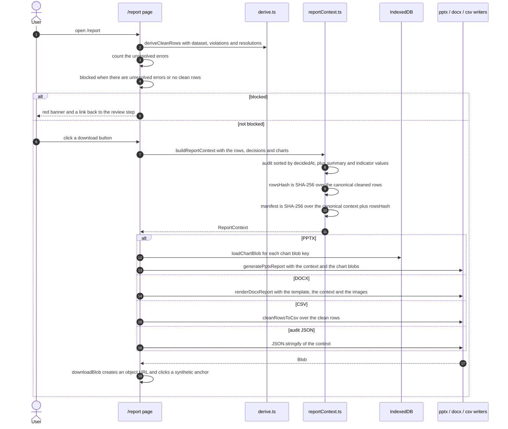
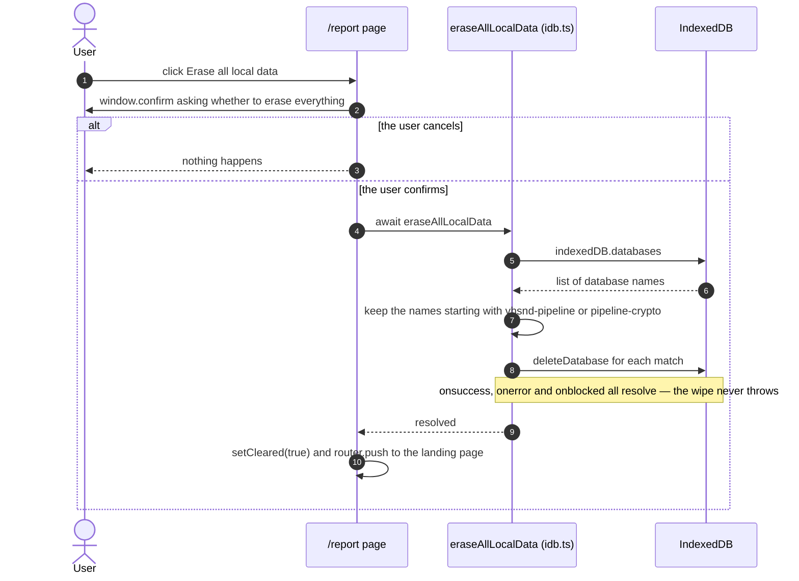

# 05 — Application Workflows

> **Scope of this document.** The four user journeys — import, review/adjudicate, visualise, export
> — described step by step with the code that runs at each step, plus the four mechanisms that
> govern them: the ingest state machine, the worker handoff, the partial-comparison gate, and the
> erase/wipe flow.
>
> **Evidence rule.** Every non-trivial claim is cited as `file:line` and was read from the working
> tree. Anything that could not be established from the repository is written as
> **"Not verified from the current repository."**
>
> **Companion documents** — [`04-system-architecture.md`](04-system-architecture.md) (layers, worker
> strategy, error handling) · [`PIPELINE.md`](PIPELINE.md) §3 (stage-by-stage codemap) ·
> [`diagrams/application-flow.md`](diagrams/application-flow.md) (the end-to-end flow diagram) ·
> [`07-database-documentation.md`](07-database-documentation.md) (what each step persists) ·
> [`06-modules-and-features.md`](06-modules-and-features.md) (the modules these steps use).

---

## 1. The journey map

Four stages, connected by the top nav (`src/components/AppShell.tsx:8-13`). Two of the transitions are
**hard gates**, not advice: `/review → /viz` is blocked while unresolved errors remain
(`src/app/review/page.tsx:146-153`) and `/report` refuses to export under the same condition
(`src/app/report/page.tsx:165,180-191`).



| Journey | Screen | Entry point | Terminal state |
|---|---|---|---|
| A — Import | `/ingest` | `src/app/ingest/page.tsx:20` | `phase === "done"` (`:133`) or `"error"` (`:135`) |
| B — Review & adjudicate | `/review` | `src/app/review/page.tsx:26` | every flagged row decided |
| C — Visualise | `/viz` | `src/app/viz/page.tsx:22` | chart captured into the report |
| D — Export | `/report` | `src/app/report/page.tsx:22` | file downloaded, or data wiped |

---

## 2. Journey A — Import

### 2.1 Sequence



### 2.2 Steps

| # | Step | Code | Notes |
|---|---|---|---|
| A1 | Accept the file | `src/app/ingest/page.tsx:142-151` | Single file only (`multiple: false`, `:194`). The extension guard rejects anything outside `xlsx/xls/ods/csv` and sets `phase = "error"` immediately |
| A2 | Read the bytes | `:156-159` | `file.arrayBuffer()`; the buffer is kept in state (`:159`, `raw`) so the file can be re-read without re-picking it |
| A3 | Load saved header matches | `:160` → `src/lib/storage/idb.ts:224-228` | Keyed by **file name**, not dataset id, so the next import of the same file arrives already mapped |
| A4 | Parse | `:72-82` → `src/lib/workers.ts:47-118` | See §3 |
| A5 | Create the dataset | `:85` → `src/stores/datasetStore.ts:40-58` | A fresh `crypto.randomUUID()` (`:42`), the current `SCHEMA_VERSION` and `schemaHash` attached (`:48-49`), then encrypted into the `ds` store |
| A6 | Remember what this screen imported | `:86-87,132` | `sessionDatasetId` ref (`:40`); on a re-read the superseded dataset is deleted so one file does not pile up as several copies |
| A7 | Validate | `:88-93` → `src/lib/workers.ts:121-186` | `refDate: null` makes the engine compute the reference date itself (`src/schema/engine/validate.ts:32-39`) |
| A8 | Cache the validation | `:94-99` → `src/lib/storage/idb.ts:196-198` | Stored under `datasetId` in the `validation` store |
| A9 | Compute the summary | `:100-114` | `columnsRecognized` counts only registry codes (`:100-101`); `missingCritical` is the hard-coded pair `SubmissionDate`, `B8` (`:102-104`) |
| A10 | Detect a previous import of the same file | `:119-129` | Matches on file name + row count + schema version, excluding the current and superseded ids |
| A11 | Set the active dataset | `:118` | `workflowStore.setActiveDatasetId` |
| A12 | Report | `:234-258` | Success card: rows, errors, warnings, columns recognised, missing critical columns, and the count of hand-matched columns |

### 2.3 The three post-import notices

| Notice | When | Code | Behaviour |
|---|---|---|---|
| **Orientation** | `summary.transposed` or the user overrode orientation | `:260-276` | "This export was sideways" explains that rows and columns were swapped; the button re-reads the file the other way (`rereadOtherWay`, `:171-180`) |
| **Collapsed columns** | `summary.collapsedColumns.length > 0` | `:304-322` | The paragraph comes from `collapsedNotice` (`src/lib/ingestCopy.ts:11-24`), keyed on each group's `cause` — so the screen blames the export only when the file itself repeats a code it owns |
| **Unmatched titles** | `unmapped.length > 0` | `:324-379` | One `<select>` per title over all 253 registry columns, with already-present codes disabled (`:357-365`). "Match these and read again" saves the mapping against the file name and re-reads the file (`:182-190`) |

### 2.4 The three deliberate restarts

The ingest screen can re-run the whole pipeline on the same bytes without asking the user to pick
the file again. All three go through `ingestBuffer` (`src/app/ingest/page.tsx:52-140`):

| Restart | Trigger | Effect |
|---|---|---|
| `rereadOtherWay` | `:171-180` | Re-reads with the opposite orientation (`transposed ? "upright" : "flipped"`) |
| `applyHeaderMapping` | `:182-190` | Saves the manual title matches, then re-reads with them applied |
| `onDrop` again | `:142-169` | A fresh import of the same file — **mints a new dataset id**, so prior decisions do not carry over |

---

## 3. The ingest state machine

### 3.1 The declared phases

```ts
type Phase = "idle" | "reading" | "parsing" | "validating" | "done" | "error";
```
`src/app/ingest/page.tsx:18`

### 3.2 The machine



**Verified detail — the `"parsing"` phase is declared but never assigned.** `setPhase("parsing")` does
not appear anywhere in the file; the only `setPhase` calls are `"reading"` (`:60`, `:153`),
`"validating"` (`:83`), `"done"` (`:133`) and `"error"` (`:135`, `:148`, `:164`). The parse stage is
communicated to the user through the separate `progress` string instead — the `onProgress` callback
sets it to `"Parsing workbook…"` (`:81`) and `"Checking for contradictions…"` is set directly before
validation (`:84`). `"parsing"` is nevertheless honoured by the `busy` computation
(`:202`), so the spinner shows for it if it were ever set.

### 3.3 What each phase renders

| Phase | The screen shows |
|---|---|
| `idle` | Only the drop zone |
| `reading` / `parsing` / `validating` | The drop zone plus a spinner and the progress string (`:221-226`) |
| `error` | A red card headed "Could not import this file" with the message (`:228-233`) |
| `done` | The success card (`:234-258`), then any of the three notices, then the insights panel (`:382-463`) |

`busy` is true for `reading`, `parsing` and `validating` (`:202`) and gates the "Match these and read
again" button (`:373`).

---

## 4. The worker handoff

### 4.1 Sequence



### 4.2 The handoff contract

| Aspect | Behaviour | Code |
|---|---|---|
| Worker URL | `new URL("../workers/parseWorker.ts", import.meta.url)` | `src/lib/workers.ts:52` |
| Worker type | `{ type: "module" }` — an ES-module worker | `src/lib/workers.ts:54`, `:131` |
| Probe | a worker is constructed and immediately terminated to test support | `src/lib/workers.ts:36-44` |
| Buffer transfer | `postMessage({...}, [task.buffer])` — the buffer moves, it is not copied | `src/lib/workers.ts:89` |
| Timeout | 120 000 ms → `reject(new Error("Parse timed out."))` | `src/lib/workers.ts:62` |
| Success | `msg.ok` → `clearTimeout`, `onProgress("done")`, `resolve(msg.data)` | `src/lib/workers.ts:65-68` |
| Failure | `!msg.ok` → `reject(new Error(msg.error))` | `src/lib/workers.ts:69-72` |
| Worker crash | `worker.onerror` → `reject(new Error("Parse worker error: …"))` | `src/lib/workers.ts:75-79` |
| Fallback | dynamic `import()` of the same module, calling the same `parsePayload` | `src/lib/workers.ts:98-115` |
| Non-browser | `reject(new WorkerUnavailableError())` | `src/lib/workers.ts:92-97` |

The validate path is identical, with `validatePayload` (`src/workers/validateWorker.ts:20-28`) and a
120 s timeout at `src/lib/workers.ts:138`.

**Why this cannot drift.** The worker module and the fallback call the *same* pure function:
`parsePayload` (`src/workers/parseWorker.ts:30-79`) and `validatePayload`
(`src/workers/validateWorker.ts:20-28`). The worker scope wiring is separate code
(`src/workers/parseWorker.ts:81-96`).

**Progress reporting.** `onProgress` is called with `"starting"` (`src/lib/workers.ts:48`),
`"parsing"` (`:61`, `:100`), `"validating"` (`:137`) and `"done"` (`:67`, `:112`, `:180`). The ingest
page maps every non-`"done"` phase to the literal string "Parsing workbook…"
(`src/app/ingest/page.tsx:81`).

---

## 5. Journey B — Review and adjudicate

### 5.1 Sequence



### 5.2 Steps

| # | Step | Code |
|---|---|---|
| B1 | Load the workspace | `src/app/review/page.tsx:40-44` — `loadDataset`, `loadResolutions` for the active dataset |
| B2 | Guard the empty case | `:98-104` — with no active dataset the page shows the dataset picker instead |
| B3 | Guard the loading case | `:106-117` — a spinner while the snapshot is decrypted |
| B4 | De-duplicate violations | `:51` → `src/contracts/violation.ts:42-73`. The identity key is `` `${rowId}\|${code}\|${fieldId ?? ruleId}\|${rawValue}` `` (`src/contracts/violation.ts:50`) |
| B5 | Filter by severity | `:47-50` — `all` / `error` / `warning` / `info`, with live counts in the chips (`:228-240`) |
| B6 | Derive the clean set | `:63` → `src/lib/derive.ts:40-66` |
| B7 | Compute unresolved errors | `:53` → `src/lib/derive.ts:74-90` |
| B8 | Gate the next step | `:146-153` — the button is `disabled={unresolved.length > 0}` and its `title` states how many errors are blocking |
| B9 | Re-run validation on demand | `:77-96` — `runValidate` with the dataset's own `presentColumns`, then `setValidation` |
| B10 | Show the audit log | `:304-332` — every resolution, sorted by `decidedAt` (`:320`) |
| B11 | Record a decision | `src/components/RowDrawer.tsx:75-126` → `src/stores/resolutionStore.ts:23-27` → `src/lib/storage/idb.ts:127-129` |

### 5.3 The decision rules

| Decision | Requirement | Code |
|---|---|---|
| **Keep** | Optional: acknowledge specific error codes or `__all`. With errors present and nothing acknowledged, saving is refused with "Acknowledge at least one error, or choose to keep without acknowledging (stays unresolved)." | `src/components/RowDrawer.tsx:77-92` |
| **Drop** | A written justification is **required** | `:62,94-107` |
| **Override** | A written justification is **required**, *and* the replacement value must pass the field coercer | `:62-68,109-125` |
| **Reset to pending** | Always available once a decision exists; clears the resolution back to `pending` | `:253-268` |

Overrides are re-read through the schema when the clean set is derived, so a stored replacement can
never carry a shape its column cannot hold (`src/contracts/resolution.ts:41-52` → `src/lib/derive.ts:53`).

### 5.4 What "still pending" means, precisely

`unresolvedErrors` (`src/lib/derive.ts:74-90`) returns an error-severity violation when:

- there is no resolution for the row, or the resolution status is `pending` (`:81`), **or**
- the row was kept but the specific code (or `__all`) was not acknowledged (`:83-87`).

A row that is `drop` or `override` resolves every error on it (`:82`). The review banner states
this in the user's words: the affected rows "still flow into the cleaned dataset and the report until
you keep them (with a reason), override the value, or drop them" (`src/app/review/page.tsx:220-224`).

---

## 6. Journey C — Visualise

### 6.1 Sequence



### 6.2 Steps

| # | Step | Code |
|---|---|---|
| C1 | Load dataset, resolutions and charts | `src/app/viz/page.tsx:48-53` |
| C2 | Derive clean rows | `:55-58` → `src/lib/derive.ts:40-66`. Only `rows` (kept + pending) are used — dropped rows never reach a chart |
| C3 | Pick a mode | `:39` — `indicator` or `comparison`; the mode buttons render at `:259-273` |
| C4 | Evaluate the indicator | `:64-71` → `src/schema/indicators.ts:123-276`. If the chosen indicator yields no points, the first indicator that does is used instead (`:65-69`) |
| C5 | Suggest chart kinds | `:72` → `src/schema/indicators.ts:306-345`; selecting an indicator auto-picks its top suggestion (`:97-104`) |
| C6 | Compute the comparison | `:78-81` → `src/lib/comparisons.ts:320-1090`. In comparison mode the kind is forced by the comparison itself (`:87`) and the title becomes the comparison label (`:89`) |
| C7 | **Apply the partial gate** | `:83-85` — see §7 |
| C8 | Render | `:374-380` → `src/components/ChartCanvas.tsx` |
| C9 | Capture | `:126-158` — `toPng` at `pixelRatio: 2` on a white background (`:130-134`); the config records kind, id, title, value key, series, bins, `extra` and insight (`:136-147`) |
| C10 | Persist | `:148-152` → `src/stores/chartStore.ts:38-66` → `src/lib/storage/idb.ts:150-185`. The blob key is `` `${datasetId}/${chartId}.png` `` (`src/stores/chartStore.ts:50`) |
| C11 | Hydrate thumbnails | `:106-124` — blobs are decrypted into object URLs and revoked on cleanup (`:122`) |
| C12 | Remove a chart | `:453-465` → `src/stores/chartStore.ts:68-71` → `src/lib/storage/idb.ts:166-173`, which deletes the blob too |

**A capture failure is swallowed into the console** — `console.error("Chart capture failed:", err)`
(`src/app/viz/page.tsx:153-157`). It is the only `console` call in the application; see
[`04-system-architecture.md`](04-system-architecture.md) §9.

---

## 7. The partial-comparison gate

This is the mechanism that stops a partial file from being read as a smaller result.

### 7.1 The decision



### 7.2 The rules

| Rule | Code |
|---|---|
| The gate key is `datasetId \| comparisonId \| mode` — switching comparison or mode re-arms the gate | `src/app/viz/page.tsx:83` |
| `missingColumns` comes from `compResult.columnsMissing` and is empty in indicator mode | `:84` |
| `awaitingPartial` is true when there are missing columns **and** the user has not opted in for this exact key | `:85` |
| While withheld, `ChartCanvas` is **not rendered at all** | `:335` (the withheld branch replaces the chart entirely) |
| The withheld card names the comparison, lists the missing columns, and explains why nothing is drawn | `:357-362` |
| "Show partial anyway" sets `partialFor` to the current key | `:363-365` |
| After opting in, a "Partial view — not in this file: …" line is shown above the chart | `:369-373` |
| A "Not in this file: …" chip appears next to the chart-type readout | `:320-324` |
| "Add to report" is disabled while the chart is withheld | `:417` (`disabled={capturing \|\| awaitingPartial}`) |
| The comparison's own insight sentence lists the missing columns | `src/lib/comparisons.ts:259-261` |

### 7.3 Why the missing-column list is trustworthy

`columnsMissing` is built from `inFile` (`src/lib/comparisons.ts:44-48`), which reads
`presentColumns` off the first clean row — the codes the **source file physically carried**. It does
**not** fall back to "does any row have a value for this column" unless the caller supplies no
`presentColumns` at all. So the chip names columns the file genuinely lacks, never a column the file
carried but left blank. This is the distinction that `presentColumns` exists to protect
(`src/contracts/resolution.ts:22-27`).

---

## 8. Journey D — Export

### 8.1 Sequence



### 8.2 The export block conditions

| Condition | Effect | Code |
|---|---|---|
| `unresolved > 0` | The blocking banner appears: "N unresolved error(s) must be fixed before a report can be generated." | `src/app/report/page.tsx:165,180-191` |
| `clean.rows.length === 0` | The banner reads "The cleaned dataset is empty; import a dataset and review it first." | `:185` |
| Blocked | The **PPTX**, **DOCX** and **CSV** buttons are disabled (`disabled={blocked \|\| running !== null}`) | `:197,200,203` |
| Blocked | The **audit JSON** button is **not** disabled by `blocked` — it is gated only on `running !== null`, so the audit log can always be exported | `:206` |
| A DOCX template is missing | The DOCX button is disabled and reads "DOCX (template pending)" with the tooltip "Install a template in templates/ first." | `:200-202`; the template is looked up at `:55` |
| An export is running | All four buttons are disabled (`running !== null`) | `:197-207` |
| The export throws | The message is shown under the buttons in red | `:122-126,210-212` |

The export block is a **hard gate**, not a warning — the same condition also disables "Continue to
Visualise" on the review screen (`src/app/review/page.tsx:146-153`).

### 8.3 What is produced

| Format | Builder | File name | Notes |
|---|---|---|---|
| PPTX | `src/export/pptxReporter.ts:20-112` | `vhsnd-report-<yyyy-mm-dd>.pptx` | Title slide, cleaning summary, key indicators, one slide per saved chart, audit appendix. The manifest prefix is printed on the title slide (`:39`) |
| DOCX | `src/export/docxReporter.ts:13-51` | `vhsnd-report-<yyyy-mm-dd>.docx` | `docx-templates` with `{{ }}` delimiters and a `{{chartImage blobKey}}` helper (`:29-42`); pixels are converted to cm at 96 dpi (`:11`) |
| CSV | `src/export/csv.ts:17-30` | `cleaned-<original name>.csv` | Header is `label (code)` (`:22-24`), booleans are `1`/`0` (`:12`), CRLF line endings (`:29`) |
| Audit JSON | the whole `ReportContext` | `audit-<original name>.json` | `src/app/report/page.tsx:87-90` |

Every download uses `downloadBlob` (`src/export/csv.ts:32-41`): an object URL, a synthetic `<a>`,
a click, and a deferred `URL.revokeObjectURL` after 5 s (`:40`).

### 8.4 The manifest

`buildReportContext` (`src/export/reportContext.ts:64-119`) produces a deterministic context:

| Field | Content | Code |
|---|---|---|
| `audit` | Every non-`pending` resolution, sorted by `decidedAt` | `:65-74` |
| `summary` | Kept / dropped / pending rows, error / warning / info counts, unresolved count | `:76-80,97-105` |
| `indicators` | One headline value per indicator: the single point value if there is one, otherwise the number of points, rounded to 2 dp | `:82-86` |
| `charts` | id, title, kind, blobKey | `:106` |
| `rowsHash` | SHA-256 of the canonical string of all cleaned row values | `:114` |
| `manifest` | SHA-256 of the canonical JSON of the whole context plus `rowsHash` | `:111-116` |

`canonicalString` (`src/export/reportContext.ts:35-42`) sorts object keys recursively, which is what
makes the hash reproducible regardless of property-insertion order.

**Known limitation.** The exports embed the PNG that was captured at add-time
(`src/app/report/page.tsx:92-118`). Re-editing a chart afterwards does not update a previously saved
deck — a silent divergence between the report and the current data, recorded in
[`PROJECT_CONTEXT.md`](../PROJECT_CONTEXT.md) §16.3.

---

## 9. The erase / wipe flow



### 9.1 The wipe

| Step | Code |
|---|---|
| The button and its copy | `src/app/report/page.tsx:238-240` — "Erase all local data", disabled once `cleared` |
| The confirmation | `:130` — `window.confirm("Erase ALL datasets, corrections, charts and drafts from this device? This cannot be undone.")` |
| The call | `:131` → `src/lib/storage/idb.ts:260-273` |
| Guard | `if (typeof indexedDB === "undefined") return;` (`src/lib/storage/idb.ts:261`) |
| Discovery | `await indexedDB.databases()` (`:262`) |
| Filter | `d.name?.startsWith("vhsnd-pipeline") \|\| d.name?.startsWith("pipeline-crypto")` (`:265`) |
| Deletion | `indexedDB.deleteDatabase(d.name!)` per match, with `onsuccess`, `onerror` and `onblocked` all resolving (`:266-271`) — **the wipe never throws and never blocks on another tab** |
| After the wipe | `setCleared(true)` and `router.push("/")` (`:132-133`) |

### 9.2 What the wipe destroys

Because the filter is a **prefix** match, the wipe removes:

- the `vhsnd-pipeline` database in full — the `ds` snapshots, the `res` decisions, the `chart`
  metadata, the `blob` PNGs, the `validation` caches, **and** the `ui` store, which holds the saved
  manual header matches (`hdr:<fileName>`, `src/lib/storage/idb.ts:217-222`) and the persisted
  Zustand workflow state (`src/lib/storage/idb.ts:239-252`);
- the `pipeline-crypto` database — which holds the AES-256-GCM key under `app-key-v1`
  (`src/lib/crypto.ts:3-4`).

**Consequence, stated plainly.** Deleting the key makes every encrypted dataset unrecoverable.
There is no passphrase, no key export and no backup path (`src/lib/crypto.ts:59-82`); the wipe is
therefore irreversible by design, and the confirmation dialog says so.

**Scope note.** The wipe is a *local* action. It deletes the databases from this browser profile
only; it cannot and does not reach any other machine.

---

## 10. Cross-journey invariants

| Invariant | Where it is enforced |
|---|---|
| No data leaves the origin | CSP `connect-src 'self' data: blob:` (`src/app/layout.tsx:19`) + the build gate `scripts/check-offline.mjs:18-34` |
| A dataset id is unique per import | `crypto.randomUUID()` (`src/stores/datasetStore.ts:42`) |
| A dataset records the schema it was read under | `schemaVersion` + `schemaHash` (`src/stores/datasetStore.ts:48-49`, computed at `src/schema/index.ts:33-38`) |
| Dropped rows never reach charts or reports | `deriveCleanRows` puts them in `dropped`, not `rows` (`src/lib/derive.ts:59-62`) |
| Rows with unresolved errors still flow (and are counted as pending) | `src/lib/derive.ts:50,63`; `src/app/review/page.tsx:217-226` |
| Every drop/override carries a written reason | `src/components/RowDrawer.tsx:62,94-97` |
| Every export carries a SHA-256 manifest | `src/export/reportContext.ts:111-116` |
| A percentage is never shown bare | `pctPoint` / `countPoint` / `meanDetail` attach `unit` and `detail` to every point (`src/lib/comparisons.ts:71-94,125-131`) |
| A partial comparison is never silently drawn | `src/app/viz/page.tsx:335-366` |
| Nothing is deleted except by explicit action or the ingest re-read rule | `src/app/report/page.tsx:129-134`; `src/app/ingest/page.tsx:130-132` |
