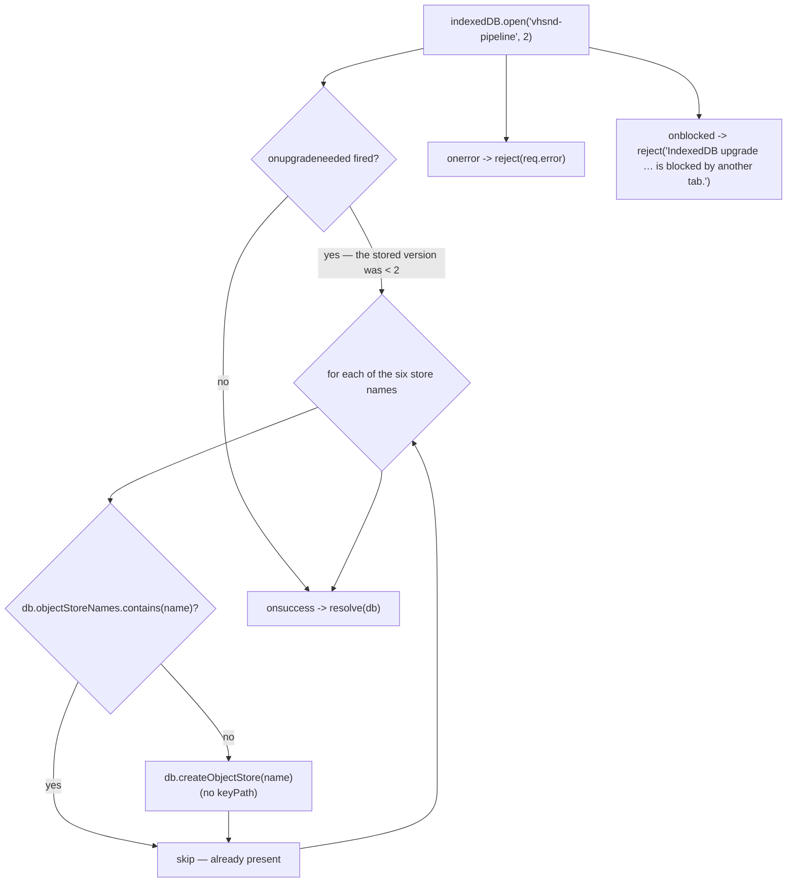
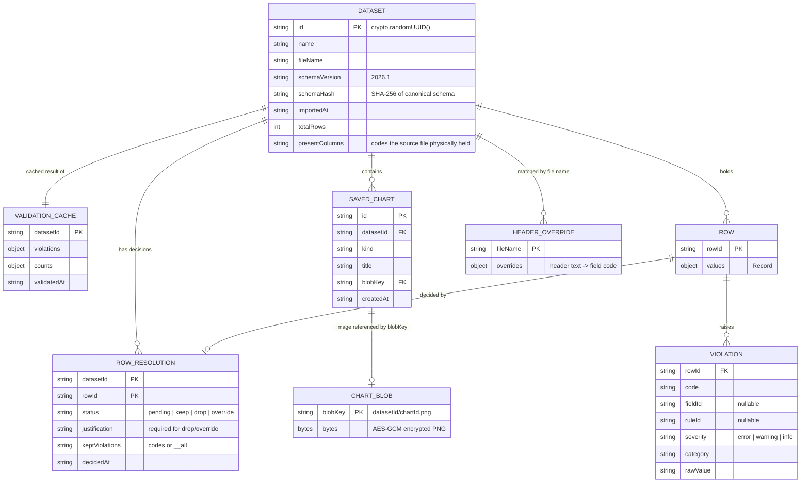
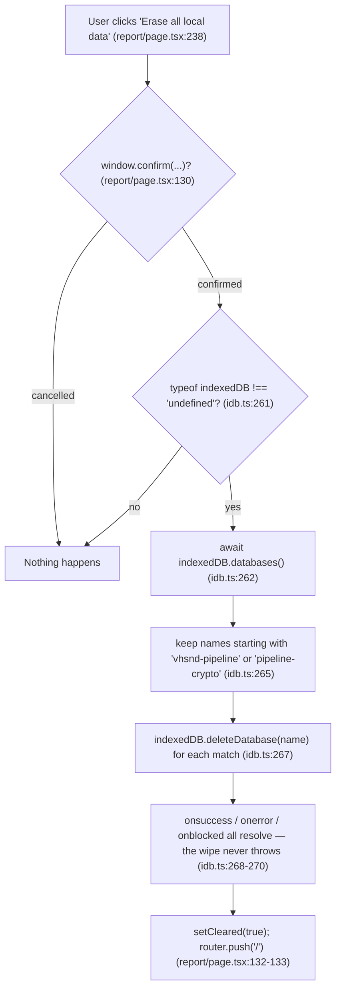

# 07 — Database Documentation

> **Scope of this document.** The persistence layer of the application: what is stored, where, under
> which key, in what form, how it is upgraded, how transactions behave, and how it is destroyed.
>
> **Evidence rule.** Every non-trivial claim is cited as `file:line` and was read from the working
> tree. Anything that could not be established from the repository is written as
> **"Not verified from the current repository."**
>
> **Companion documents** — [`04-system-architecture.md`](04-system-architecture.md) §8 (caching) and
> §12 (the egress guarantee) · [`05-application-workflows.md`](05-application-workflows.md) §9 (the
> wipe flow) · [`diagrams/database-er-diagram.md`](diagrams/database-er-diagram.md) (the standalone ER
> diagram) · [`PROJECT_CONTEXT.md`](../PROJECT_CONTEXT.md) §6 (the canonical database summary) ·
> [`06-modules-and-features.md`](06-modules-and-features.md) §7 (the stores that write here).

---

## 1. There is no SQL database and no server database

**This application has no SQL database, no server database, no ORM, no migration framework and no
connection string.** Persistence is **browser IndexedDB** — a key/value store inside the user's own
browser profile — with encryption applied in the application layer before anything is written.

| Thing | Status | Evidence |
|---|---|---|
| SQL / relational database | **Not found in codebase** | No `sqlite`, `pg`, `mysql`, `mongoose`, `prisma` or equivalent dependency (`package.json:20-42`) |
| Server-side database | **Not found in codebase** | `output: "export"` means no server runtime exists (`next.config.ts:4`); no route handlers, no server actions, no `middleware.*` under `src/` |
| ORM / query builder | **Not found in codebase** | The only declared dependency in this space is `zod`, which is **never imported** (`package.json:31`) |
| Connection strings / credentials | **Not found in codebase** | `process.env` does not appear anywhere in `src/` |
| HTTP API for data | **Not found in codebase** | The CSP pins `connect-src` to `'self' data: blob:` (`src/app/layout.tsx:19`); the build gate fails the ship on any remote reference (`scripts/check-offline.mjs:18-34`) |

The consequence: **the database lives and dies with the browser profile.** There is no server-side
copy, no backup, no replication and no shared state between machines. Data cannot move between
origins because the AES key is bound to the origin (`src/lib/crypto.ts:59-82`).

---

## 2. Storage inventory

Two IndexedDB databases, both created lazily on first use.

| Database | Version | Object stores | Purpose | Declared at |
|---|---|---|---|---|
| `vhsnd-pipeline` | **2** | `ds`, `res`, `chart`, `blob`, `validation`, `ui` | All application data | `src/lib/storage/idb.ts:23-25` |
| `pipeline-crypto` | managed by `idb-keyval` | `keyval` | The single AES-256-GCM data key | `src/lib/crypto.ts:3` |

`DB_VERSION` is `2` (`src/lib/storage/idb.ts:24`) and the six store names are declared as a const
tuple (`:25`).

> **Naming note.** The store-name map `P` (`src/lib/storage/idb.ts:15-21`) names only five stores —
> `ds`, `res`, `chart`, `blob`, `ui`. The `validation` store is addressed by the literal string
> `"validation"` at `:197,201,207` instead of through `P`. Functionally identical; it is a small
> inconsistency in the code, not a different storage model.

---

## 3. `vhsnd-pipeline` — store by store

### 3.1 Key strategy per store

Every store is created **without a `keyPath`**: `db.createObjectStore(name)` (`src/lib/storage/idb.ts:37`).
That makes them *out-of-line* stores, where the key is supplied explicitly as the second argument
to `put(value, key)` (`src/lib/storage/idb.ts:62`). There is no `keyPath` anywhere in the codebase
and no `createIndex` call anywhere in the codebase.

| Store | Key | Key shape | Value | Encrypted |
|---|---|---|---|---|
| `ds` | `snapshot.id` | `crypto.randomUUID()` (`src/stores/datasetStore.ts:42`) | The whole `DatasetSnapshot`, JSON-serialised | Yes — string |
| `res` | `datasetId` | the same UUID | `Record<rowId, RowResolution>`, JSON-serialised — **all decisions for a dataset live in one record** | Yes — string |
| `validation` | `datasetId` | the same UUID | `ValidationCache` = `{violations, counts, byRow, validatedAt}` | Yes — string |
| `chart` | `meta.id` | `crypto.randomUUID()` (`src/stores/chartStore.ts:39`) | `StoredChartMeta` — kind, title, `config`, and the `image.blobKey` pointer | Yes — string |
| `blob` | `` `${datasetId}/${chartId}.png` `` | composite string (`src/stores/chartStore.ts:50`) | The raw PNG bytes | Yes — **byte-wise** |
| `ui` | free-form string | `hdr:<fileName>` for manual header matches (`src/lib/storage/idb.ts:221`); the Zustand persist key `workflow` (`src/stores/workflowStore.ts:23`) | JSON of the override map; the persisted workflow state | Yes — string |

### 3.2 What each store holds

#### `ds` — dataset snapshots

The single most important record in the system. `DatasetSnapshot`
(`src/contracts/dataset.ts:23-40`) holds:

| Field | Meaning |
|---|---|
| `id` | `crypto.randomUUID()` — the dataset's identity |
| `kind` | `"vhsnd"` (only value registered; `src/schema/index.ts:5`) |
| `name`, `source` | The file name, sheet name, size, header row and import timestamp (`src/contracts/dataset.ts:15-21`) |
| `schemaVersion` | The schema the file was read under, e.g. `"2026.1"` |
| `schemaHash` | SHA-256 of the canonical schema projection (`src/schema/index.ts:33-38`) — this is what makes a dataset interpretable years later |
| `totalRows`, `rows` | Every normalised row (`src/contracts/dataset.ts:31`) |
| `skippedRows` | Rows excluded at parse time, e.g. wholly empty rows (`src/schema/engine/normalize.ts:576-579`) |
| `presentColumns` | The schema codes the file **physically carried** (`src/contracts/dataset.ts:34-39`) |

Written by `saveDataset` (`src/lib/storage/idb.ts:89-91`), read by `loadDataset` (`:93-97`), listed by
`listDatasets` (`:99-117`), removed by `deleteDataset` (`:119-123`).

#### `res` — the decision record

`Record<rowId, RowResolution>` (`src/contracts/resolution.ts:3-14`), keyed by dataset id. Each
`RowResolution` carries `status` (`pending`/`keep`/`drop`/`override`), the `overrides` map, the
acknowledged `keptViolations`, the `justification`, `decidedAt` and `decidedBy`.

The whole map is re-written on every single decision (`src/stores/resolutionStore.ts:23-27` →
`src/lib/storage/idb.ts:127-129`) — one encrypted blob per dataset, not one record per row. That is
the trade-off of a key/value store with no secondary index.

#### `validation` — the cached engine result

`ValidationCache` (`src/lib/storage/idb.ts:189-194`) holds the violations, the per-severity counts,
the per-row map and `validatedAt`. It exists so that opening `/review` does not re-run the engine.
The only way to refresh it is the explicit "Re-run validation" button
(`src/app/review/page.tsx:77-96`).

#### `chart` and `blob` — captured images

`chart` holds `StoredChartMeta` (`src/lib/storage/idb.ts:139-148`): id, datasetId, kind, indicatorId,
title, createdAt, the full `ChartConfig`, and — once captured — `{width, height, blobKey}`.
`blob` holds the PNG bytes under that `blobKey`.

The split is deliberate: the metadata is a small encrypted string that can be listed cheaply, while
the image is a byte blob. `deleteChart` reads the metadata, deletes the blob, then deletes the
metadata (`src/lib/storage/idb.ts:166-173`).

#### `ui` — two unrelated things in one store

`ui` holds both the manual header matches and the persisted Zustand workflow state, because both
are "small UI preferences" and both must be wiped together.

- `hdr:<fileName>` → the JSON of the manual title→code map (`src/lib/storage/idb.ts:217-222`), read
  back by `loadHeaderOverrides` (`:224-228`). Keying by **file name** rather than by dataset id is
  what makes a manual mapping replay on the next import of the same file
  (`src/app/ingest/page.tsx:160`).
- The Zustand `workflow` key → written through `createEncryptedStorage` (`src/lib/storage/idb.ts:239-252`),
  which is the adapter handed to `persist` (`src/stores/workflowStore.ts:24`).

### 3.3 The cost of no indexes

Because no store has an index on `datasetId`, the two queries that need to filter by dataset read
**every record** and filter in JavaScript:

| Query | Behaviour |
|---|---|
| `listDatasets()` | `getAllKeys()` on `ds`, then a **sequential decrypt of every snapshot** to build the summary list (`src/lib/storage/idb.ts:99-117`) — O(n) decrypts on every landing-page mount (`src/app/page.tsx:47-55`) |
| `loadChartMetas(datasetId)` | `getAllKeys()` on `chart`, then a decrypt of **every** chart metadata, filtering by `meta.datasetId` afterwards (`src/lib/storage/idb.ts:154-164`) |

The `blob` store avoids this because its key **starts with** the dataset id, so a per-dataset listing
would be a key-range scan — but no such scan is implemented today.

---

## 4. `pipeline-crypto` — the key store

A second, separate IndexedDB database created by `idb-keyval`'s
`createStore("pipeline-crypto", "keyval")` (`src/lib/crypto.ts:1,3`), holding exactly one entry:
the raw 256-bit AES-GCM key, under the key name `app-key-v1` (`src/lib/crypto.ts:4`).

Why it is a **separate database**:

1. The privacy wipe deletes both, so the key cannot outlive the data
   (`src/lib/storage/idb.ts:260-273`).
2. The key is never co-located with the ciphertext in the same object store, so a store-level
   inspection of `vhsnd-pipeline` never yields a usable key.

Lifecycle: the key is generated on first use with
`crypto.subtle.generateKey({name:"AES-GCM", length:256}, true, ["encrypt","decrypt"])`
(`src/lib/crypto.ts:74-77`), exported to raw bytes (`:78`) and written under `app-key-v1` (`:79`).
It is then cached in module scope as `cachedKey` (`:59-62,80`) so subsequent operations do not
re-read the store.

**There is no key recovery.** No passphrase, no key export/import, no rotation, no backup. Clearing
site data destroys the key and therefore every encrypted dataset. `app-key-v1` is fixed for the life
of the installation. The trade-off is deliberate and documented in the code comment
(`src/lib/crypto.ts:9-17`): protect health data at rest on shared district machines *without* the
user-friction of a passphrase.

---

## 5. The encryption scheme

Everything persisted is encrypted **in the application layer**, before it reaches IndexedDB. The
database itself stores ciphertext only.

| Property | Value | Cite |
|---|---|---|
| Algorithm | `AES-GCM`, 256-bit | `src/lib/crypto.ts:5,74` |
| IV | **12 random bytes, fresh per operation** | `:20,43` |
| IV source | `crypto.getRandomValues(new Uint8Array(12))` | `:20,43` |
| String ciphertext format | **`v1.<base64 IV>.<base64 ciphertext>`** | `:16,26` |
| String decryption | splits on `.`, requires exactly 3 parts with the first equal to `v1`, otherwise throws `"Unsupported encrypted payload format."` | `:30-33` |
| Byte ciphertext format | **`[IV(12) ‖ ciphertext]`** — one contiguous buffer, IV first | `:41-49` |
| Byte decryption | `iv = bytes.slice(0,12)`, `cipher = bytes.slice(12)` | `:51-57` |
| Base64 | hand-rolled `btoa`/`atob` over a byte string, not `String.fromCharCode(...args)` | `:84-95` |
| Key handling | imported as a non-extractable-after-import `CryptoKey` for operations; the raw bytes are exported only once, at creation | `:65-71,74-79` |

### 5.1 Which records are encrypted, and how

| Record | Encryption call | Result in IndexedDB |
|---|---|---|
| Dataset snapshot | `encryptString(JSON.stringify(snapshot))` | `src/lib/storage/idb.ts:90` → a `v1.…` string |
| Resolutions | `encryptString(JSON.stringify(map))` | `:128` → a `v1.…` string |
| Validation cache | `encryptString(JSON.stringify(cache))` | `:197` → a `v1.…` string |
| Chart metadata | `encryptString(JSON.stringify(meta))` | `:151` → a `v1.…` string |
| Chart PNG | `encryptBytes(bytes)` | `:177` → `[IV ‖ ciphertext]` as a `Uint8Array` |
| Header overrides | `encryptString(JSON.stringify(map))` | `:221` → a `v1.…` string |
| Zustand workflow state | `encryptString(value)` | `:246` → a `v1.…` string |

The AES key itself is the one record that is **not** encrypted — it is the key.

### 5.2 The consequence

Because the encryption lives in the application layer, and not in IndexedDB, **any code that can
read the database can also decrypt it** — the key is in the same origin. The protection is against
*disk and copy artefacts* on a shared machine, and against an accidental look at browser storage by
someone who does not know the app's format. It is not protection against code running in the origin.
This is stated as the threat model in `src/lib/crypto.ts:9-17`.

---

## 6. The upgrade and self-heal path

| Step | Behaviour | Cite |
|---|---|---|
| Open | `indexedDB.open(DB_NAME, DB_VERSION)` — always at the **explicit** version 2 | `src/lib/storage/idb.ts:33` |
| Upgrade | `req.onupgradeneeded` runs; it creates any store that is missing and touches nothing else | `:34-39` |
| Success | `req.onsuccess` resolves the connection | `:40` |
| Error | `req.onerror` rejects with the request error | `:41` |
| Blocked | `req.onblocked` rejects with a human-readable message naming the database | `:42` |
| Caching | the connection promise is memoised in `dbPromise`, so the database is opened **once** per page session | `:28-45` |

**This is the "self-heal" path**, and the comment at `:5-13` explains why it exists: an earlier
build used `idb-keyval`'s `createStore`, which pins every database at version 1 with different store
names, so such a database could never be upgraded and its transactions died with `NotFoundError`.
Opening at an explicit version and creating any missing store repairs that state.

**What self-heal does *not* do.** It creates missing stores; it never **removes** an orphaned store
left over from an earlier build, and it never rewrites, re-encrypts or transforms existing records.
There is no `oldVersion` check anywhere in the file.

---

## 7. Transaction handling

**Verified from `src/lib/storage/idb.ts`: every operation uses its own transaction on exactly one
object store. There is no cross-store atomicity anywhere in the application.**

| Primitive | Transaction | Cite |
|---|---|---|
| `objectStore(store, mode)` | `openDB().then(db => db.transaction(store, mode).objectStore(store))` — **one store per transaction** | `src/lib/storage/idb.ts:47-49` |
| `storeSet` | its own `readwrite` transaction | `:59-66` |
| `storeGet` | its own `readonly` transaction | `:68-71` |
| `storeDelete` | its own `readwrite` transaction | `:73-80` |
| `storeKeys` | its own `readonly` transaction | `:82-85` |

There is no `db.transaction([...stores], ...)` call anywhere — the multi-store form of the IndexedDB
API is never used.

### 7.1 What this means in practice

Multi-record operations are **not atomic**. Each one is a sequence of independently-committed
transactions, and a failure part-way through leaves the earlier steps committed:

| Operation | Transactions | Failure mode |
|---|---|---|
| `deleteDataset(id)` | (1) delete `ds[id]`, (2) delete `res[id]` (`src/lib/storage/idb.ts:119-123`) | The dataset row is gone but the resolutions remain if step 2 fails — orphaned decisions |
| `deleteChart(id)` | (1) read `chart[id]`, (2) delete `blob[blobKey]`, (3) delete `chart[id]` (`:166-173`) | A blob can be deleted while its metadata survives, leaving a chart whose image is gone |
| `chartStore.addChart` | (1) `saveChartBlob`, (2) `saveChartMeta` (`src/stores/chartStore.ts:51,54`) | A PNG can be stored with no metadata pointing at it — an orphaned blob |
| `datasetStore.removeDataset` | (1) `deleteDataset`, (2) `deleteValidation` (`src/stores/datasetStore.ts:92-98`) | A validation cache can outlive its dataset |

There is no compensating logic, no retry and no reconciliation pass for any of these.

### 7.2 Another gap worth stating

`deleteDataset` removes the snapshot and the resolutions but **not** the charts or their blobs — the
comment at `src/lib/storage/idb.ts:122` says the charts "are removed separately by the store", but no
code path does that. Deleting a dataset therefore leaves its chart metadata and PNG blobs behind in
the `chart` and `blob` stores.

---

## 8. Indexes

**There are no indexes.** No `createIndex` call exists anywhere in `src/`, and no `keyPath` is
declared on any store.

| Aspect | Reality |
|---|---|
| Object stores | Created with `db.createObjectStore(name)` — **out-of-line**, key supplied per `put` (`src/lib/storage/idb.ts:37,62`) |
| Secondary indexes | **None** |
| Unique constraints | **None** |
| Range queries | Only `getAllKeys()` (`src/lib/storage/idb.ts:84`) — there is no `IDBKeyRange` use anywhere |
| Filtering | Done in JavaScript after decrypting every candidate (`src/lib/storage/idb.ts:99-117,154-164`) |

The primary key is the store's own key path (out-of-line), and uniqueness is guaranteed by
IndexedDB itself for that key — two `put` calls with the same key overwrite.

---

## 9. Constraints

**IndexedDB enforces no constraints of its own here.** Every integrity rule in this application is
enforced in **application code**, before the write reaches the store.

| Constraint | Enforced by | Where |
|---|---|---|
| A dataset id is unique | `crypto.randomUUID()` at creation | `src/stores/datasetStore.ts:42` |
| A drop or override must carry a written justification | The drawer refuses to save | `src/components/RowDrawer.tsx:62,94-107` |
| An override value must fit its field's type | `coercer.reject` before saving, and the value is re-coerced on derivation | `src/components/RowDrawer.tsx:63-68`; `src/schema/engine/normalize.ts:188-196`; `src/contracts/resolution.ts:41-52` |
| A keep with unacknowledged errors stays unresolved | `unresolvedErrors` | `src/lib/derive.ts:74-90` |
| A row cannot be both kept and dropped | One `RowResolution` per `rowId` in a single map | `src/contracts/resolution.ts:3`; `src/stores/resolutionStore.ts:24` |
| A column's code is unique in a dataset | The first occurrence wins; the rest are recorded as `collapsedColumns` | `src/schema/engine/normalize.ts:508-535` |
| A chart belongs to exactly one dataset | `datasetId` on the metadata; the blob key embeds it | `src/lib/storage/idb.ts:141`; `src/stores/chartStore.ts:50` |
| A blob belongs to a chart | `SavedChart.image.blobKey` points at the `blob` record | `src/contracts/chart.ts:48-53` |
| A resolution belongs to a dataset | `res` is keyed by `datasetId`; the map is replaced wholesale on each decision | `src/lib/storage/idb.ts:127-129` |
| Only registry codes count as "recognised" | The check against `VHSND_COLUMNS` | `src/app/ingest/page.tsx:100-101` |

**There are no foreign keys and no referential integrity at the database level.** The relationships
in §11 are enforced purely by the application writing the right `datasetId` on every child record.

---

## 10. Migrations and seeding

### 10.1 Migrations

| Aspect | Reality |
|---|---|
| Current version | `DB_VERSION = 2` (`src/lib/storage/idb.ts:24`) |
| Migration framework | **None.** No migration table, no migration runner, no `oldVersion` switch anywhere in `src/` |
| Upgrade logic | `onupgradeneeded` creates any missing object store and nothing else (`:34-39`) |
| Data transformation | **None.** No record is rewritten, re-encrypted or re-keyed on upgrade |
| Schema (survey) versioning | A **separate** mechanism: `SCHEMA_VERSION = "2026.1"` (`src/schema/index.ts:4`) with a `SCHEMAS` map (`:8-10`). Datasets record `schemaVersion` + `schemaHash` (`src/contracts/dataset.ts:28-29`), and `getDatasetSchema` throws for an unknown version (`:23`) |
| Effect of a schema version bump | An **older dataset cannot be coerced** — `buildFieldCoercer` throws, `src/lib/derive.ts` catches it and falls back to a `null` coercer (`:30-35`), so the dataset still opens but its override values are no longer re-coerced |

The `SCHEMAS` map is already shaped for a second version (`src/schema/index.ts:8-10`), and datasets
record the version and hash they were read under, so a future `2026.2` can be added without
invalidating existing snapshots. **Not verified from the current repository** — no second schema
version exists.

### 10.2 Seeding

**There is no seeding.** No fixture data is written into IndexedDB by the application, by a script
or by the build.

| Thing | Reality |
|---|---|
| Seed scripts | **None.** `scripts/` contains nine maintenance scripts, none of which writes to IndexedDB (`scripts/` — `gen-columns.mjs`, `make-sample-data.cjs`, `make-shape-sample.mjs`, `make-default-templates.mjs`, `embed-templates.mjs`, `check-offline.mjs`, `diagnose-workbook.cjs`, `diagnose-workbook.mjs`, `debug-raw.cjs`) |
| Test fixtures | **Not seeds.** They are files on disk: `sample-data/vhsnd-sample.xlsx`, `sample-data/DATA_EX_SHAPE.csv`, `sample-data/DATASET_1.xlsx` — read by the test suite through the parse functions, never written into IndexedDB |
| First-run content | **None.** The landing page shows "No datasets on this machine yet." (`src/app/page.tsx:99`) |
| The only auto-generated record | The AES key, created on first use by `getAppKey` (`src/lib/crypto.ts:74-79`) |

---

## 11. Conceptual ER diagram

IndexedDB has no foreign keys, so the relationships below are **logical, enforced in application
code** by the `datasetId` carried on every child record. It is drawn as an ER diagram because that is
how the data actually relates.

The standalone version of this diagram is in
[`diagrams/database-er-diagram.md`](diagrams/database-er-diagram.md).

### 11.1 Reading the diagram against the stores

| Entity | Where it really lives |
|---|---|
| `DATASET` | One `ds` record (`src/lib/storage/idb.ts:89-91`) |
| `ROW` | **Inside** the dataset snapshot's `rows` array — there is no `rows` object store |
| `VIOLATION` | Inside the `validation` record's `violations` array and `byRow` map (`src/lib/storage/idb.ts:189-194`) |
| `ROW_RESOLUTION` | Inside the single `res` record for the dataset — a map, not a row per decision (`src/lib/storage/idb.ts:127-129`) |
| `VALIDATION_CACHE` | One `validation` record |
| `SAVED_CHART` | One `chart` record |
| `CHART_BLOB` | One `blob` record |
| `HEADER_OVERRIDE` | One `ui` record under `hdr:<fileName>` (`src/lib/storage/idb.ts:217-222`) |

The diagram is therefore **conceptual, not physical**. Only `DATASET`, `VALIDATION_CACHE`,
`ROW_RESOLUTION` (as a map), `SAVED_CHART`, `CHART_BLOB` and `HEADER_OVERRIDE` correspond to actual
records; `ROW` and `VIOLATION` are nested inside other records.

One relationship in the diagram deserves a caveat: `DATASET ||--o{ HEADER_OVERRIDE` is drawn by
analogy, but header overrides are keyed by **file name**, not by `datasetId`
(`src/lib/storage/idb.ts:221`), so a header override can outlive the dataset it was created for and
applies to any later import of the same file name.

---

## 12. The wipe path

`eraseAllLocalData` (`src/lib/storage/idb.ts:260-273`) is the permanent, irreversible destruction of
the local workspace.

| Step | Code |
|---|---|
| Button and copy | `src/app/report/page.tsx:238-240` |
| Confirmation dialog | `:130` — "Erase ALL datasets, corrections, charts and drafts from this device? This cannot be undone." |
| Guard for a non-browser environment | `src/lib/storage/idb.ts:261` |
| Discovery | `:262` — `indexedDB.databases()` |
| Filter | `:265` — a **prefix** match on `vhsnd-pipeline` or `pipeline-crypto` |
| Deletion | `:267` — `indexedDB.deleteDatabase(d.name!)` |
| Never throws | `:268-270` — success, error **and blocked** all resolve, so a second open tab cannot hang the wipe |
| After the wipe | `src/app/report/page.tsx:132-133` — `setCleared(true)` and `router.push("/")` |

Because the filter is a prefix match, **both** databases are removed in full: the six stores of
`vhsnd-pipeline` (snapshots, decisions, chart metadata, PNG blobs, validation caches, header
overrides and the persisted workflow state) **and** the `pipeline-crypto` key store.

The irreversible consequence, stated plainly: **deleting the key makes every encrypted dataset
unrecoverable.** There is no passphrase, no key export and no backup
(`src/lib/crypto.ts:59-82`). The wipe is local to this browser profile; it cannot reach any other
machine.

---

## 13. Data retention and lifecycle

| Aspect | Reality |
|---|---|
| Retention period | **None.** No TTL, no expiry, no quota management, no eviction (`src/lib/storage/idb.ts` — no such logic exists) |
| What deletes data | Only (a) the explicit wipe (`src/app/report/page.tsx:129-134`), (b) the ingest re-read rule that deletes the dataset the ingest screen itself created (`src/app/ingest/page.tsx:86-87,132`), and (c) `deleteDataset` / `deleteChart` / `removeChart` |
| What is *not* deleted with the dataset | Chart metadata and PNG blobs — `deleteDataset` removes only `ds[id]` and `res[id]` (`src/lib/storage/idb.ts:119-123`) |
| Backups | **None.** No export, import or sync of the dataset store |
| Migration between machines | **Impossible** — the key is bound to the origin (`src/lib/crypto.ts:59-82`) and there is no key export |
| Quota | Subject to the browser's IndexedDB quota, with no handling for a quota-exceeded error — `req.onerror` simply rejects (`src/lib/storage/idb.ts:64`) and the page shows the message |
| Size of a dataset | One encrypted JSON blob holding every row (`src/lib/storage/idb.ts:89-91`); a full survey snapshot is held in memory *and* on disk (`src/stores/datasetStore.ts`) |

---

## 14. Summary

| Concern | Answer |
|---|---|
| SQL / server database | **None.** Persistence is browser IndexedDB |
| Databases | 2 — `vhsnd-pipeline` v2 (6 stores) and `pipeline-crypto` (1 store) |
| Stores | `ds`, `res`, `chart`, `blob`, `validation`, `ui` |
| Key strategy | Explicit out-of-line keys; no `keyPath`, no indexes, no `createIndex` anywhere |
| Encryption | AES-256-GCM, fresh 12-byte IV per operation; strings as `v1.<iv>.<cipher>`, bytes as `[IV ‖ cipher]`; key in a separate database under `app-key-v1` |
| Transactions | **One transaction per operation, one store per transaction.** No cross-store atomicity anywhere |
| Upgrade | `onupgradeneeded` creates missing stores only — the self-heal path (`src/lib/storage/idb.ts:34-39`) |
| Migrations | **None.** `DB_VERSION = 2`; no framework, no data transformation |
| Seeding | **None.** Fixtures are files on disk, not database seeds |
| Constraints | Enforced in application code, not in the database |
| Foreign keys | **None.** Relationships are logical, enforced by `datasetId` |
| Wipe | `eraseAllLocalData` deletes both databases; never throws; irreversible |
| Recovery | **None.** No passphrase, no key export, no backup |
