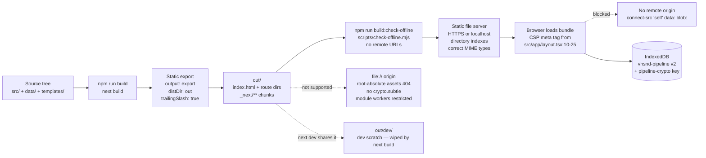

# 14 — Deployment and Infrastructure

**Scope:** how this repository becomes something a health official can open in a browser — the build
artefact, the exact commands, the requirements the *serving* side must satisfy, what cannot work, and
what is simply not written down anywhere.

**Four facts up front:**

1. `npm run build` produces a **pure static export** in `out/` — six HTML routes plus hashed JS/CSS
   chunks. There is no Node process, no server-side rendering and no database at runtime
   (`next.config.ts:4`, `PROJECT_CONTEXT.md` §13.1).
2. The app **must be served over HTTPS or `localhost`**, because `crypto.subtle` — which does both the
   AES-GCM encryption and the SHA-256 manifest — only exists in a secure context
   (`src/lib/crypto.ts:21`, `src/export/reportContext.ts:45`).
3. **`out/` cannot be opened from disk.** `file://` breaks the app for three independent reasons
   (§3 below).
4. **The hosting provider, the production URL, the operator and the rollout procedure are not
   documented anywhere in this repository.** See §7 — marked *Not verified from the current repository*.

Related reading: [`13-testing-and-quality.md`](13-testing-and-quality.md) (the gates), [`12-development-guide.md`](12-development-guide.md)
(the contributor workflow), [`DEVELOPMENT.md`](DEVELOPMENT.md) (the short companion), [`PIPELINE.md`](PIPELINE.md)
(the codemap), [`../PROJECT_CONTEXT.md` §13](../PROJECT_CONTEXT.md#13-deployment) (the single-file source of truth),
[`diagrams/deployment-architecture.md`](diagrams/deployment-architecture.md) (the standalone diagram file).

---

## 1. The artefact

### 1.1 Build configuration

`next.config.ts` is 13 lines in total, and four of them decide the whole deployment shape:

```ts
const nextConfig: NextConfig = {
  output: "export",          // next.config.ts:4
  trailingSlash: true,       // next.config.ts:5
  distDir: "out",            // next.config.ts:6
  images: { unoptimized: true },  // next.config.ts:7-9
  reactCompiler: true,       // next.config.ts:10
};
```

| Key | Value | Deployment consequence |
| --- | --- | --- |
| `output` | `"export"` (`next.config.ts:4`) | The build emits files, not a server. **There is no Node process in the shipped artefact.** `next start` refuses to run (§8). |
| `trailingSlash` | `true` (`next.config.ts:5`) | URLs become `/ingest/`, `/review/`, `/viz/`, `/report/`, and the export is **directory-style** (`out/ingest/index.html`). A static server must resolve a directory request to its `index.html`. |
| `distDir` | `"out"` (`next.config.ts:6`) | The export lands in `out/`. **This is also the dev server's scratch directory** — see §4. |
| `images.unoptimized` | `true` (`next.config.ts:7-9`) | No image-optimisation server is required. There are no remote images in the app (`PROJECT_CONTEXT.md` §14.6). |
| `reactCompiler` | `true` (`next.config.ts:10`) | Build-time only. No runtime effect on deployment. |

There is **no `basePath`, no `assetPrefix` and no `headers()`/`rewrites()`/`redirects()`** in
`next.config.ts`. Next.js itself warns that `headers`, `rewrites` and `redirects` "will not
automatically work with `output: export`" (`node_modules/next/dist/server/config.js:479-485`) — and
since none are declared, the export has no routing rules of its own. **All URL handling is the static
server's job.**

### 1.2 The exact build command

```bash
npm run build        # -> "next build"        (package.json:8)
```

`next build` performs the export as part of the build — `next export` was removed in Next.js 14 in
favour of `output: "export"` (`node_modules/next/dist/docs/01-app/02-guides/static-exports.md:371`).
There is no separate export step to forget.

**On this repository's checkout path specifically** — the path contains an `&`, and in PowerShell 5.1
the `npm`/`npx` shims have been unreliable here (`PROJECT_CONTEXT.md` §12.6). Call the binary directly:

```powershell
node .\node_modules\next\dist\bin\next build
```

**The full shippable pipeline** is `npm run build:all` (`package.json:17`):

```
npm run build            -> next build                      (package.json:8)
npm run build:check-offline -> node scripts/check-offline.mjs (package.json:16)
npm run embed:templates  -> make-default-templates.mjs -> embed-templates.mjs (package.json:14)
```

Two things to know about that chain:

- **The offline gate is *not* part of `npm run ci`** (`package.json:18` chains `typecheck → lint →
  test → build` only). If you ship from CI, run `build:all` or add `build:check-offline` explicitly.
- **`embed:templates` runs *after* the build.** It regenerates `src/export/templates.generated.ts` from
  `templates/default/` — a *source* file (`PROJECT_CONTEXT.md` §5, "Generated files — never hand-edit").
  If you change a DOCX template you must **re-run `npm run build`** afterwards, or the shipped bundle
  will still contain the previous template bytes.

### 1.3 The shape of `out/`

A clean export contains:

```
out/
  index.html            -> /
  ingest/index.html     -> /ingest/
  review/index.html     -> /review/
  viz/index.html        -> /viz/
  report/index.html     -> /report/
  _not-found/index.html -> /_not-found/   (auto-generated; no source file)
  404.html              -> the not-found page for the static server
  _next/static/...      -> hashed JS/CSS chunks + the module-worker bundles
  favicon.ico, *.svg    -> public/ assets
```

The route list is the one in `PROJECT_CONTEXT.md` §7.3, confirmed against the export produced by
`npm run build` (`PROJECT_CONTEXT.md` §15.4, "Build → `out/`, 6 routes").

> The working tree currently also contains **`out/dev/`** — that is the dev server's scratch space,
> not part of the export. See §4.

### 1.4 The six routes

| URL | Source file | Exported file | Notes |
| --- | --- | --- | --- |
| `/` | `src/app/page.tsx` | `out/index.html` | Landing page, dataset list, privacy note |
| `/ingest/` | `src/app/ingest/page.tsx` | `out/ingest/index.html` | Drop zone, header mapping |
| `/review/` | `src/app/review/page.tsx` | `out/review/index.html` | Violation table, adjudication |
| `/viz/` | `src/app/viz/page.tsx` | `out/viz/index.html` | Charts, PNG capture |
| `/report/` | `src/app/report/page.tsx` | `out/report/index.html` | Exports, manifest, data wipe |
| `/_not-found/` | *(none — auto-generated)* | `out/_not-found/index.html` | **Not found in codebase** as a source file |

All five source pages are `"use client"` (`src/app/page.tsx:1`, `src/app/ingest/page.tsx:1`,
`src/app/review/page.tsx:1`, `src/app/viz/page.tsx:1`, `src/app/report/page.tsx:1`), so the export is
a single client bundle with no server-rendered data. There are **no dynamic routes** and therefore no
`generateStaticParams` requirement.

### 1.5 What is *not* in the artefact

| Absent | Why it matters |
| --- | --- |
| Any server-side code | `output: "export"` (`next.config.ts:4`). Nothing to run, nothing to patch, nothing to scale. |
| Any API route / server action | No `route.ts` and no `"use server"` directive anywhere under `src/` (`PROJECT_CONTEXT.md` §7.1). |
| A database | Persistence is browser IndexedDB (`src/lib/storage/idb.ts`). Nothing is stored server-side. |
| A service worker | No SW registration anywhere in `src/` (`PROJECT_CONTEXT.md` §2.2 F27). **"Works offline" depends entirely on how `out/` is served and on the browser cache** — the artefact precaches nothing. |
| A `.env` file or any environment variable | `process.env` does not appear in `src/` (`PROJECT_CONTEXT.md` §11.1). The build has no configuration inputs. |

---

## 2. Serving requirements

### 2.1 HTTPS or `localhost` — non-negotiable

`crypto.subtle` is used in three places:

| Call | Purpose | Consequence if unavailable |
| --- | --- | --- |
| `crypto.subtle.encrypt` / `decrypt` (`src/lib/crypto.ts:21`, `:37`, `:44`, `:55`) | AES-256-GCM encryption of every IndexedDB record | Every dataset, resolution, chart and validation cache becomes unreadable |
| `crypto.subtle.digest("SHA-256", …)` (`src/export/reportContext.ts:45`) | The report manifest | Exports cannot be produced |
| `crypto.subtle.generateKey` / `importKey` / `exportKey` (`src/lib/crypto.ts:65`, `:74`, `:78`) | Key creation and recovery | The key cannot be created or re-imported |

`crypto.subtle` is exposed only in a **secure context**: `https://` origins and `http://localhost` /
`127.0.0.1`. On a plain `http://` origin served from a district LAN or a file share, the app will load
and then fail at the first encrypted write — with a message like *"Cannot read properties of
undefined"* rather than anything actionable. **This is the single most common way to deploy this app
incorrectly.**

### 2.2 A static file server that honours directory indexes

Because `trailingSlash: true` (`next.config.ts:5`), the browser requests `/ingest/` and the server
must serve `out/ingest/index.html` for it. Next.js's own reference configuration for a static host is:

```nginx
root /var/www/out;
location / {
    try_files $uri $uri.html $uri/ =404;
}
```

(`node_modules/next/dist/docs/01-app/02-guides/static-exports.md:339-361`). The `try_files … $uri/`
arm is what resolves a directory request to its `index.html`.

**This nginx snippet is a reference example reproduced from the Next.js documentation. It is not a
configuration for this project's host — no host has been chosen (§7).**

### 2.3 Correct MIME types for module workers

The parse and validate stages run in **ES module workers**, constructed as
`new Worker(new URL("../workers/parseWorker.ts", import.meta.url), { type: "module" })`
(`src/lib/workers.ts:52-54`, `:130-131`). A module worker is only accepted by the browser if the
script is served with a **JavaScript MIME type** (`text/javascript` or `application/javascript`); a
`text/plain` or `application/octet-stream` response is refused, and the app silently falls back to the
main thread (§ `16-error-handling-and-logging.md`).

Relatedly, the CSP allows `worker-src 'self' blob: data:` (`src/app/layout.tsx:21`) so that both the
bundled module worker and any blob-URL worker are permitted.

### 2.4 Headers this app cannot set for itself

The Content-Security-Policy is delivered as a **`<meta http-equiv>` tag**
(`src/app/layout.tsx:31`), not as an HTTP response header. A meta-tag CSP therefore **cannot express
`frame-ancestors` or `report-uri`** (see `15-security-documentation.md` §3). If clickjacking protection
is wanted, it must be set by the server as `X-Frame-Options: DENY` / `SAMEORIGIN` or as a
`frame-ancestors` response header. **No such header is configured anywhere in this repository**, because
no server configuration exists (§7).

### 2.5 Requirement summary

| Requirement | Required because | If missing |
| --- | --- | --- |
| HTTPS, or `http://localhost` | `crypto.subtle` secure context | Encryption, persistence and the manifest all fail |
| Directory-index resolution | `trailingSlash: true` | `/ingest/` 404s; only `/ingest/index.html` would work |
| `text/javascript` for `.js` | module workers | Worker creation fails; pipeline runs on the main thread instead (slower, still correct) |
| Long-lived `Cache-Control` for `/_next/static/**` | hashed chunks are immutable | Re-download on every visit (a performance, not a correctness, problem) |
| `frame-ancestors` / `X-Frame-Options` | cannot come from a meta CSP | Clickjacking protection is **absent** unless the server adds it |
| No server-side API, database or secret | there is nothing to configure | — |

---

## 3. `file://` is **not** supported

Despite being a static export, the `out/` folder **cannot be opened directly from disk**. This is not a
styling nit; the app is non-functional under `file://`. Three independent reasons:

### 3.1 Reason 1 — root-absolute asset URLs resolve to the filesystem root

Next.js emits **root-absolute** asset URLs into the static HTML. Verified against the export in this
working tree — every chunk reference in `out/index.html` is of the form:

```
href="/_next/static/chunks/<hash>.css"
src="/_next/static/chunks/<hash>.js"
```

(the exact hashes change on every build; the **leading slash** does not).

Under `file://` there is no origin, so `/_next/...` resolves against the **filesystem root**
(`C:/_next/...` on Windows, `/_next/...` on POSIX). Every stylesheet and every script 404s, the page
renders unstyled, and no React code runs at all.

There is no `basePath` setting that would fix this (`next.config.ts` has none), and Next.js's static
export does not emit relative asset paths.

### 3.2 Reason 2 — `crypto.subtle` is not available in a `file://` origin

`file://` is not a secure context in mainstream browsers, so `crypto.subtle` is undefined. The very
first encrypted write — `encryptString` → `getAppKey` → `crypto.subtle.generateKey`
(`src/lib/crypto.ts:18-21`, `:74`) — throws. Nothing can be persisted, and the SHA-256 manifest
(`src/export/reportContext.ts:45`) cannot be computed.

### 3.3 Reason 3 — module workers and blob URLs are restricted under `file://`

`new Worker(url, { type: "module" })` from a `file://` document is blocked or behaves inconsistently
across browsers: the worker script inherits an opaque origin, and the `blob:` URLs the pipeline uses
for captured chart images (`src/app/viz/page.tsx:135`, `URL.createObjectURL` at `:114`) are subject to
the same origin restrictions. The app does survive this — `src/lib/workers.ts:90-116` falls back to
running the identical payload inline on the main thread — but the `file://` origin still breaks §3.1
and §3.2 outright.

### 3.4 What "served from a file share" means

The CSP comment and the user-facing copy in the app talk about being served from a file share
(`src/app/layout.tsx:12-14`, `src/app/page.tsx:62-64`). That means **an HTTP(S) file share — a
WebDAV/SharePoint/S3 endpoint served over HTTPS — not a USB stick opened in Explorer.** The `file://`
origin and "a file share" are different things.

---

## 4. The `out/` sharing gotcha — `next dev` and `next build` share one directory

`distDir: "out"` (`next.config.ts:6`) means the **dev server's scratch space and the production export
are the same directory**. Verified in this working tree:

```
out/dev/
  build/  cache/  logs/  server/  static/  types/
  build-manifest.json  fallback-build-manifest.json  package.json
  prerender-manifest.json  routes-manifest.json  trace
```

### 4.1 The sequence that breaks things

| Step | What happens |
| --- | --- |
| `npm run dev` | `next dev` writes its scratch build into `out/dev/` and serves from there. |
| `npm run build` (while dev is running) | `next build` **rebuilds `out/` from scratch** and deletes `out/dev/`. The running dev server's own manifests are removed out from under it. |
| → | **The dev server is now broken until it is restarted.** Restarting `next dev` recreates `out/dev/`. |

**Rule: restart the dev server after any build, and do not run a build while the dev server is up.**

### 4.2 The offline gate knows about this

`scripts/check-offline.mjs` explicitly skips the dev directory so that dev-only tooling cannot fail the
shipping gate:

```js
// `next dev` writes scratch chunks to out/dev. They are gitignored and
// never part of the static export, and they link to dev-only tooling, so
// they must not be able to fail the shipping gate.
if (dir === OUT && entry === "dev") continue;   // scripts/check-offline.mjs:48-51
```

So the gate will still pass with a stale `out/dev/` present — which is convenient, but it also means
**"the gate passed" does not prove `out/` is a clean export.** `out/dev/` must be removed before the
artefact is copied to a host, or the host will serve a directory of dev chunks that nothing links to.

### 4.3 `out/` is gitignored

`.gitignore` excludes `/out/` (`PROJECT_CONTEXT.md` §11.6). The artefact is **never committed** — it
must be produced by a build on the machine that serves it, or copied there as a build step.

---

## 5. The offline gate

`scripts/check-offline.mjs` is a 56-line Node script, wired to `npm run build:check-offline`
(`package.json:16`).

### 5.1 What it actually checks

| Step | Code | Behaviour |
| --- | --- | --- |
| Preconditions | `:13-16` | If `out/` does not exist, print *"Missing build output. Run `npm run build` first."* and exit 1. **The gate cannot pass before a build.** |
| Pattern 1 — remote calls | `:18` | `/(?:fetch\|WebSocket\|EventSource\|XMLHttpRequest)\(\s*["'\`](https?:\/\/[^"'\`]+)/g` — a network call whose **first argument is a literal `http(s)://` URL**. |
| Pattern 2 — remote assets | `:19` | `/(?:src\|href)=["'](https?:\/\/)/g` — an `src` or `href` attribute pointing at an `http(s)://` origin, in HTML **and** in JS. |
| Walk | `:22`, `:46-55` | Recursively walks `out/`, **skipping `out/dev/`** (`:51`). |
| File filter | `:23` | Only files matching `/\.(js\|html)$/`. |
| Read window | `:25` | HTML is read whole; **a `.js` file is read only for its first 400 000 characters** (`text.slice(0, 400_000)`). |
| Report | `:30` | Up to 20 violations are printed with file and match context. |
| Verdict | `:31-35` | Non-zero exit with *"N network reference(s) found. Refusing to ship."*, else *"OK - no remote references in static export."* |

### 5.2 What it does **not** check — read this before trusting it

| Not checked | Consequence |
| --- | --- |
| CSS files (`.css`) are not scanned (`:23`) | A remote `url()` in a stylesheet would pass. There is none today, but the gate would not catch one. |
| JSON, SVG, WASM, map files are not scanned | Same class of gap. |
| Only the **first 400 KB** of each `.js` file (`:25`) | A remote URL past that offset would pass. The bundle is large enough that this is not hypothetical. |
| A URL built at runtime (`fetch(url)` where `url` is a variable) | Not matched — the regex requires a **literal** URL argument. |
| A `WebSocket`/`EventSource`/`XHR` opened to a relative or protocol-relative URL | Not matched (the pattern requires `https?://`). |
| **That a workable origin exists** | The gate proves *absence of remote references*, not *presence of a serveable site*. It says nothing about TLS, MIME types or directory indexes. |
| That the site is offline-capable | There is no service worker (§1.5). |

### 5.3 What it is for

The gate exists to make *"the artefact cannot phone home"* a **diff-able, reviewable property** rather
than a promise — see the script's own header comment (`scripts/check-offline.mjs:3-7`). It complements
the CSP's `connect-src 'self' data: blob:` (`src/app/layout.tsx:19`), which is the runtime enforcement
of the same property; the gate is the *build-time* enforcement.

---

## 6. Deployment architecture diagram

The standalone diagram lives at [`diagrams/deployment-architecture.md`](diagrams/deployment-architecture.md).
It is reproduced here, extended with the IndexedDB persistence path and the `out/dev/` collision, so
this document is self-contained:



---

## 7. What is **not** documented: host, URL, operator, rollout

**Plainly: the hosting provider, the production URL, the operator and the rollout procedure are not
documented anywhere in this repository. All four are *Not verified from the current repository*.**

This was checked, not assumed. A repository-wide search for deployment artefacts
(`Dockerfile`, `docker-compose*`, `vercel.json`, `netlify.toml`, `firebase.json`, `.github/**`,
`wrangler.toml`, `.gitlab-ci.yml`, `azure-pipelines.yml`, `Jenkinsfile`) returns **no matches**.

| Question | Status | Evidence |
| --- | --- | --- |
| Which host serves `out/`? | **Not verified from the current repository.** | No hosting config of any kind exists. `PROJECT_CONTEXT.md` §13.2 records the same conclusion. |
| What is the production URL? | **Not verified from the current repository.** | No URL appears in any config, script, doc or source file. |
| Who operates it? | **Not verified from the current repository.** | No `CODEOWNERS`, no `CONTRIBUTING.md`, no operator contact. |
| How are updates rolled out to district machines? | **Not verified from the current repository.** | No release process, no versioning scheme for the artefact, no changelog, no rollback plan. `package.json:2` still reads `"version": "0.1.0"`. |
| Is there a Dockerfile? | **No.** | No `Dockerfile` in the repository. Consistent with "no server, no database, no Docker" (`PROJECT_CONTEXT.md` §12.1). |
| Is there CI config? | **No.** | No `.github/`, no other CI configuration. `npm run ci` exists for local use (`package.json:18`); **nothing runs it** (`PROJECT_CONTEXT.md` §16.6). |
| Is there hosting config? | **No.** | No `vercel.json`, `netlify.toml`, `firebase.json` or equivalent. |
| Is there a changelog / release tag scheme? | **No.** | No `CHANGELOG.md`; `git tag --list` returns **no tags**. `package.json:2` still reads `"version": "0.1.0"`. |

### 7.1 The one weak signal, and why it is not evidence

`.gitignore` lists `.vercel` (`PROJECT_CONTEXT.md` §11.6). That is the **default Next.js ignore list**,
not evidence of a Vercel deployment. **Do not read it as "this is deployed on Vercel."** Any statement
about the host would be a guess.

### 7.2 What *is* documented, as requirements

What the repository does specify is the **contract the host must satisfy** — §2 above, plus the
`file://` prohibition (§3) and the `out/dev/` caveat (§4). Those constraints, not a provider, are the
deployment specification.

---

## 8. `npm start` does not work for this project

`package.json:9` defines `"start": "next start"`. **That script cannot serve this application**, and
Next.js itself says so. From the installed Next.js 16.3.6:

```js
// node_modules/next/dist/server/next.js:245-246
} else if (conf.output === 'export') {
    throw Object.defineProperty(new Error(`"next start" does not work with "output: export" configuration. Use "npx serve@latest out" instead.`), ...
```

Because `next.config.ts:4` sets `output: "export"`, `next start` **throws immediately** with that
message. There is no server build in `.next/` to start: `next build` in export mode emits `out/`, not a
server bundle.

**The correct way to serve the app locally for a smoke test** is any static file server over `out/`,
for example:

```bash
npx serve@latest out     # the command Next.js itself suggests (next.js:246)
```

…served over `http://localhost`, which is a secure context (§2.1). `npx serve` is a **development
convenience**; it is not a production deployment and it is not pinned by this repository.

`npm run dev` (`next dev`) remains the development server. It writes to `out/dev/` (§4).

---

## 9. A derived pre-flight checklist

**This checklist is derived by this document from the cited sources. It is not a procedure found in the
repository — no such procedure exists (§7).** Use it as a smoke test, not as an approval checklist.

| # | Check | How | Pass criterion |
| --- | --- | --- | --- |
| 1 | Build succeeds | `npm run build` | exit 0, `out/` produced |
| 2 | Export is clean | `npm run build:check-offline` | `[check-offline] OK - no remote references in static export.` |
| 3 | Exactly six routes | list `out/*/index.html` + `out/index.html` | `/`, `/ingest/`, `/review/`, `/viz/`, `/report/`, `/_not-found/` |
| 4 | No dev artefacts | `out/dev/` must not exist | absent — remove it if present (§4.2) |
| 5 | Served over HTTPS or localhost | open the URL | `crypto.subtle` is defined |
| 6 | Directory indexes work | open `/ingest/` | the ingest page loads, not a 404 |
| 7 | JS MIME type correct | `curl -I <host>/_next/static/chunks/<hash>.js` | `Content-Type: text/javascript` |
| 8 | CSP is applied | view source | `<meta http-equiv="Content-Security-Policy" …>` present (`src/app/layout.tsx:31`) |
| 9 | Nothing leaves the origin | import a file, watch the network panel | zero cross-origin requests |
| 10 | Crypto round-trips | import → reload → open the dataset | dataset still listed on `/` after a reload |

---

## 10. Cross-references

| Concern | Document |
| --- | --- |
| The CSP in full, directive by directive | [`15-security-documentation.md`](15-security-documentation.md) |
| Build/serve failure modes, worker fallback | [`16-error-handling-and-logging.md`](16-error-handling-and-logging.md) |
| Build gates and how to run them here | [`13-testing-and-quality.md`](13-testing-and-quality.md) §4, [`DEVELOPMENT.md`](DEVELOPMENT.md) |
| The codemap of the export pipeline | [`PIPELINE.md`](PIPELINE.md) |
| Everything about the project, cited | [`../PROJECT_CONTEXT.md`](../PROJECT_CONTEXT.md) §13, §16 |
| Deployment diagram, standalone | [`diagrams/deployment-architecture.md`](diagrams/deployment-architecture.md) |

**Verified against the working tree at commit `dd9c0bf` (branch `main`).** Claims that could not be
established from the repository are marked *Not verified from the current repository* rather than guessed.
