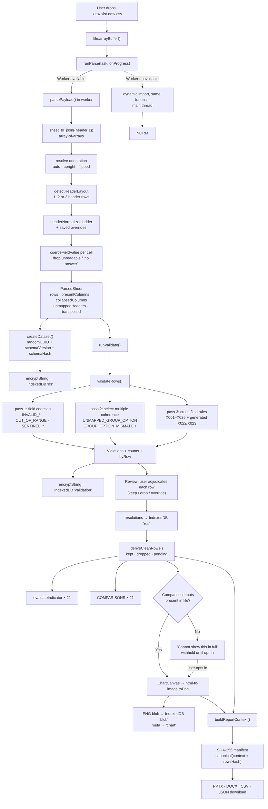

# Application Flow

End-to-end pipeline flow: ingest → parse → validate → review → derive → viz → report, including the
worker fallback path and the partial-comparison gate. Based on `PROJECT_CONTEXT.md` §4.3.

## Diagram

## Explanation

- **Ingest** reads the sheet to an array-of-arrays so repeated "Others (Specify)" labels never collapse
  (`src/workers/parseWorker.ts:43-48`); orientation is resolved, headers mapped, cells coerced.
- **Worker fallback**: `runParse`/`runValidate` (`src/lib/workers.ts`) try a module Worker first and
  fall back to a dynamic `import()` of the same module on the main thread; both call the same pure
  payload function.
- **Dataset creation** mints a `crypto.randomUUID()` id and attaches `schemaVersion` + `schemaHash`
  before encrypting into IndexedDB `ds` (`src/stores/datasetStore.ts:40-58`).
- **Validation** runs three passes (`src/schema/engine/validate.ts:41-95`): field coercion, select-multiple
  coherence, cross-field rules; a throwing rule degrades to `RULE_EVALUATION_ERROR` instead of crashing.
- **Review** records keep/drop/override decisions with justification into IndexedDB `res`
  (`src/app/review/page.tsx:304-332`).
- **Derivation** (`src/lib/derive.ts:40-66`) applies resolutions; kept rows carrying unresolved errors
  remain `pending` but still flow into charts/reports.
- **Partial-comparison gate** (`src/app/viz/page.tsx:335-366`): a comparison whose columns the file
  lacks is not drawn until the user opts in; once opted in it carries a "Partial view" line and
  "Add to report" unlocks.
- **Export** is blocked while unresolved errors exist or the cleaned set is empty; the manifest is
  SHA-256 over canonical JSON of context + rows hash (`src/export/reportContext.ts:111-118`).

## Key files cited

| Stage | Files |
|---|---|
| Ingest / parse | `src/app/ingest/page.tsx:60-137,142-169`, `src/workers/parseWorker.ts:31,43-48`, `src/schema/engine/normalize.ts:322-408,480-599`, `src/schema/engine/headerNormalizer.ts:419-437` |
| Worker fallback | `src/lib/workers.ts:26-29,36-58,63,90-116,128-134,139,163-184` |
| Dataset creation | `src/stores/datasetStore.ts:40-58` |
| Validation | `src/schema/engine/validate.ts:32-95`, `src/workers/validateWorker.ts` |
| Persistence | `src/lib/storage/idb.ts:23-45` (stores), `src/lib/crypto.ts` |
| Review | `src/components/RowDrawer.tsx:62,113-116`, `src/app/review/page.tsx:146-153,304-332`, `src/lib/derive.ts:40-66,74-90` |
| Viz / partial gate | `src/app/viz/page.tsx:39,126-158,335-366` |
| Export | `src/app/report/page.tsx:87-91,129-134,180-191`, `src/export/reportContext.ts:64-119`, `src/export/pptxReporter.ts`, `src/export/docxReporter.ts`, `src/export/csv.ts` |
