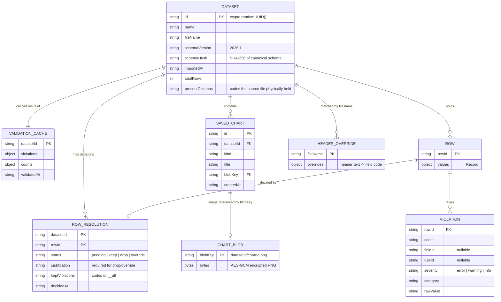

# Database ER Diagram (conceptual)

IndexedDB has no foreign keys; the relationships below are **logical, enforced in application code** by
the `datasetId` carried on every child record. Rendered as an ER diagram because that is how the data
actually relates. Based on `PROJECT_CONTEXT.md` §6.4.

## Diagram

## Explanation

- Two IndexedDB databases: `vhsnd-pipeline` v2 (`src/lib/storage/idb.ts:23-26`, stores created in
  `onupgradeneeded` at `:30-45`) and `pipeline-crypto` (separate `idb-keyval` store holding the
  AES-256-GCM key under `app-key-v1`, `src/lib/crypto.ts:3`).
- `ds` stores encrypted `DatasetSnapshot`s keyed by `snapshot.id`; `res` stores per-dataset
  `Record<rowId, RowResolution>` keyed by `datasetId`; `chart` stores `StoredChartMeta`; `blob`
  stores captured PNG bytes keyed by `` `${datasetId}/${chartId}.png` ``; `validation` stores the
  `ValidationCache`; `ui` stores header overrides (`hdr:<fileName>`) plus Zustand workflow persistence.
- Every child record carries `datasetId`; `ROW`/`VIOLATION`/`ROW_RESOLUTION` are logical children of
  `DATASET` even though `ds` holds rows inside the snapshot.
- `HEADER_OVERRIDE` is keyed by `fileName` (not `datasetId`): saved manual header matches replay on
  the next read of a file with the same name (`src/app/ingest/page.tsx` F3).
- All values are encrypted at rest (AES-GCM, fresh 12-byte IV per operation); `eraseAllLocalData()`
  deletes both databases (`src/lib/storage/idb.ts:260-273`).

## Key files cited

| Concern | Files |
|---|---|
| DB declaration / upgrade | `src/lib/storage/idb.ts:23-45` |
| Read/write helpers | `src/lib/storage/idb.ts` (`saveDataset`, `loadDataset`, `listDatasets`, `deleteDataset`, `saveResolutions`, `loadResolutions`, `saveChartMeta`, `loadChartMetas`, `deleteChart`, `saveChartBlob`, `loadChartBlob`, `saveValidation`, `loadValidation`, `saveHeaderOverrides`, `loadHeaderOverrides`, `eraseAllLocalData`) |
| Crypto key store | `src/lib/crypto.ts:3,18,59-82` |
| Encryption scheme | `src/lib/crypto.ts:20,41-49,53` |
| Wipe | `src/lib/storage/idb.ts:260-273` |
| Contracts | `src/contracts/dataset.ts`, `src/contracts/violation.ts`, `src/contracts/resolution.ts`, `src/contracts/chart.ts` |
