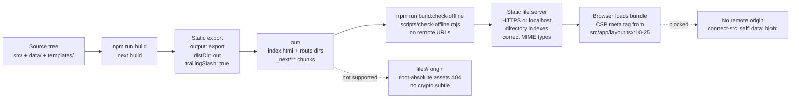

# Deployment Architecture

Static export flow from source to a static host, with the CSP meta tag, the absence of a server, and the
`file://` caveat. Based on `PROJECT_CONTEXT.md` §13.

## Diagram

## Explanation

- `next.config.ts:4-6` sets `output: "export"`, `trailingSlash: true`, `distDir: "out"`, so `npm run
  build` emits plain HTML/CSS/JS with no Node process, no SSR and no database at runtime
  (`PROJECT_CONTEXT.md` §13.1).
- `images.unoptimized: true` (`next.config.ts`) avoids needing an image-optimisation server.
- The offline gate (`scripts/check-offline.mjs:18-34`) scans `out/**/*.{js,html}` and fails if any remote
  URL is referenced; it verifies absence of remote references, not a workable origin.
- Serving requires HTTPS (or `localhost`) so `crypto.subtle` is available, a static server honouring
  directory indexes (because of `trailingSlash`), and correct MIME types for ES module workers.
- The CSP is injected as a `<meta http-equiv>` in `src/app/layout.tsx:10-25,31`; `connect-src 'self'
  data: blob:` is what enforces "nothing is uploaded".
- **`file://` is not supported**: root-absolute `/_next/...` asset URLs 404 under `file://`, `crypto.subtle`
  is unavailable in a `file://` origin, and module workers/blob URLs are restricted. "Served from a file
  share" means an HTTP file share, not a USB stick opened in Explorer.
- No hosting provider, URL, operator or rollout procedure is defined in the repo (`§13.2` — TBD).

## Key files cited

| Concern | Files |
|---|---|
| Build config | `next.config.ts:4-6,10` |
| CSP | `src/app/layout.tsx:10-25,31` |
| Offline gate | `scripts/check-offline.mjs:18-34` |
| Build scripts | `package.json` (`build`, `build:check-offline`, `build:all`, `ci`) |
| Serving requirements | `PROJECT_CONTEXT.md` §13.3-13.4 |
| Rollout caveat | `PROJECT_CONTEXT.md` §13.5 (`out/dev/` collision) |
