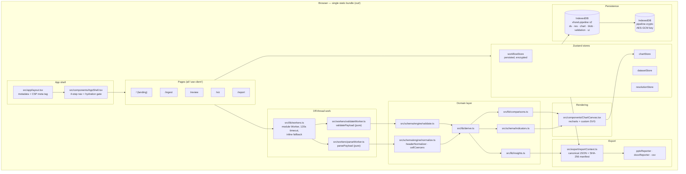

# System Architecture

Container/component view of the offline-first, browser-only pipeline. Everything runs in a single
static bundle (`out/`); there is no server tier. Based on `PROJECT_CONTEXT.md` §4.2.

## Diagram

## Explanation

- **Shell** (`src/app/layout.tsx`, `src/components/AppShell.tsx`) renders metadata, the CSP meta tag, the
  four-step nav, and a hydration gate that blocks content until the encrypted workflow store hydrates.
- **Routes** are all `'use client'` pages: `/`, `/ingest`, `/review`, `/viz`, `/report`
  (`src/app/*/page.tsx`).
- **State** is four Zustand stores (`src/stores/`): `workflowStore` (persisted, encrypted),
  `datasetStore`, `resolutionStore`, `chartStore`.
- **Heavy work** is off-thread via `src/lib/workers.ts`, which constructs module workers with a 120 s
  timeout and falls back to a dynamic `import()` of the same module on the main thread. Both paths call
  the same pure `parsePayload` / `validatePayload`.
- **Domain layer** holds normalisation, validation, derivation, indicators, comparisons and insights.
- **Rendering** is `ChartCanvas.tsx` (recharts + four hand-built SVG/DOM renderers).
- **Export** builds a deterministic `ReportContext` with a SHA-256 manifest, then PPTX/DOCX/CSV/JSON.
- **Persistence** is two IndexedDB databases: `vhsnd-pipeline` v2 (six stores) and `pipeline-crypto`
  (AES-GCM key), encrypted at rest (`src/lib/crypto.ts`).

## Key files cited

| Layer | Files |
|---|---|
| Shell | `src/app/layout.tsx:10-25,31`, `src/components/AppShell.tsx:8-13,19-32` |
| Routes | `src/app/page.tsx`, `src/app/ingest/page.tsx`, `src/app/review/page.tsx`, `src/app/viz/page.tsx`, `src/app/report/page.tsx` |
| State | `src/stores/workflowStore.ts`, `datasetStore.ts`, `resolutionStore.ts`, `chartStore.ts` |
| Workers | `src/lib/workers.ts:36-58,63,90-116,128-134,139,163-184` |
| Domain | `src/schema/engine/normalize.ts`, `headerNormalizer.ts`, `validate.ts`, `src/lib/derive.ts`, `src/schema/indicators.ts`, `src/lib/comparisons.ts`, `src/lib/insights.ts` |
| Rendering | `src/components/ChartCanvas.tsx` |
| Export | `src/export/reportContext.ts`, `pptxReporter.ts`, `docxReporter.ts`, `csv.ts` |
| Persistence | `src/lib/storage/idb.ts:23-45`, `src/lib/crypto.ts` |
